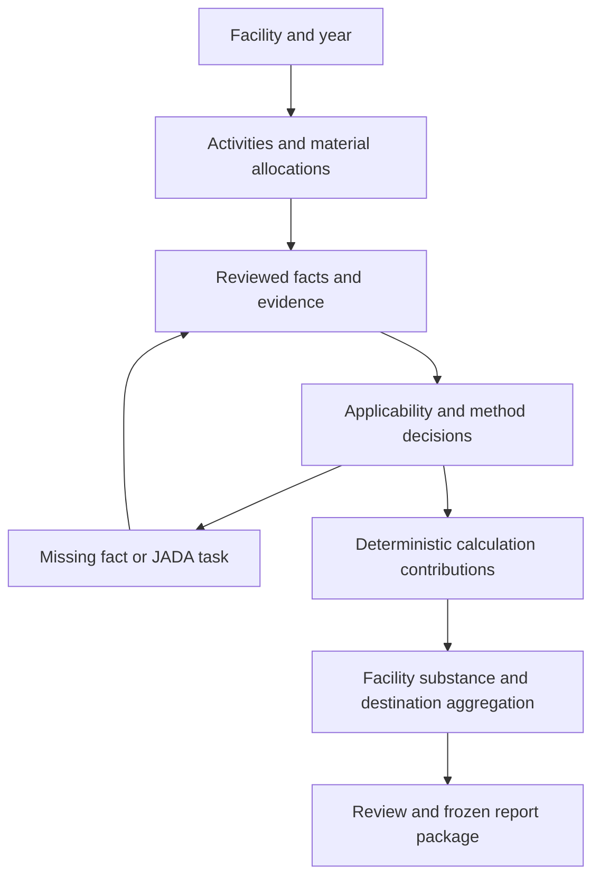

# Welding facility NPRI roadmap for the 2026 pilot

Prepared: 2026-11-04. Status: proposed product and implementation roadmap, grounded in the sources reviewed. This is a coverage design, not a completed regulatory specification or a claim that every method has been validated.

## Recommended product boundary

Build a facility reporting workspace with a small collection of reusable calculation modules. Screen the whole facility from the first beta. Automate common, supported cases in stages; require an evidenced JADA calculation for relevant cases that remain manual. A package can be complete with reviewed manual contributions, but cannot be complete while a relevant activity is unknown or unsupported.

The initial client group is welding and metal fabrication businesses. Their operations can include much more than welding. The catalogue covers 28 process and supporting-activity families, with variants, including blasting, paint, cleaning, machining, fuel use, waste and water. It is a broad discovery catalogue, not a claim that every shop has every activity or that a finite checklist can anticipate every unusual business. The questionnaire includes an explicit other-process branch.

Pilot reporting year: **2026**. JADA reviews and files the package. The published deadline is June 1, 2027 ([ECCC deadlines](https://www.canada.ca/en/environment-climate-change/services/national-pollutant-release-inventory/report/deadlines-changes.html)). No schedule estimate is implied by the cycles below.

## Read this set in order

1. This roadmap: scope, development cycles, annual runtime, and acceptance gates.
2. [Process catalogue](process-catalogue.md): what to discover, method/factor dependencies, evidence, and per-process implementation work.
3. [Conditional questionnaire](questionnaire.md): client wording, routing, evidence options, and JADA decisions.
4. [Sources and unresolved interpretations](sources-and-decisions.md): source editions, supplied files, current authority, discrepancies, and verification limits.

The existing [implementation brief](../next-calculation-implementation.md) describes small decision functions. This roadmap adds the facility-wide coverage needed to decide which functions to build.

## Beta scope decisions

These are proposed product choices, not regulatory exemptions.

| Treatment | Meaning | Recommended use |
|---|---|---|
| Automatically supported | Approved method, sufficient facts, tested calculation and trace | Selected arc welding, cutting, blasting, straightforward solvent/coating and combustion cases as their cycles pass |
| Manual within beta | JADA supplies method, inputs, result and review through a structured task | Unusual materials, controls, stack cases, specialist surface treatment and incomplete factor coverage |
| Not present | Facility confirms absence for this year, with reviewer follow-up where evidence conflicts | Only then suppress that activity's detailed questions |
| Pending | Presence, data or interpretation is uncertain | Keep visible; block affected final decisions |
| Outside automated beta | Operation exceeds implemented methods | Resolve through the manual route or decline that facility's beta package; do not silently remove the activity |

**Stacks and chimneys:** retain basic outlet discovery for everyone. Detailed individual-stack assessment can be manual initially. A shop may have extractors, booths, collectors, ovens and combustion exhausts. “No individually reportable stack” does not mean “no air release.” An engineering source-to-outlet map and a regulatory individual-stack decision are separate records.

**Specialist operations:** automate detection before automating calculation. Smelting, foundries, electroplating, galvanizing, incineration and complex chemical treatment can remain manual throughout beta. They cannot be assumed absent because the business calls itself a welding shop.

**Other industries:** wastewater utility, mining, petroleum production and pulp/paper calculation packages are not automatic year-one targets. Keep a short exceptional-operations screen so a mixed facility is recognized. Ordinary workshop wash water is not automatically a wastewater treatment plant, and an arc welder is not a steelmaking electric arc furnace.

## Development cycles

Each cycle is a deliverable with an exit gate, not a time estimate. C00–C03 establish the shared foundations. C04 onward can be selected by the first clients' confirmed activities. C11 and C12 are required for a complete pilot package. Specialist methods remain a staged expansion backlog after C13.

| Cycle | Deliverable and processes | Depends on | Proof required before moving on |
|---|---|---|---|
| C00 — Source and rule baseline | Register 2026 authority, supplied substance list, method editions and known conflicts | None | Versioned sources; rule/method distinction; unresolved interpretations assigned; no old default threshold treated as universal |
| C01 — Facility discovery | Common questions; all 28 family screens; annual activity, source, material and destination records | C00 | A mixed shop can select activities, mark unknowns and identify outsourced/mobile work; no branch disappears silently |
| C02 — Facts and allocations | Reuse extraction/matching; annual usage reconciliation; consumable allocations; sequential material-flow links; chemical/group identity | C01 | Purchases and use are distinguishable; consumable splits reconcile; repeatedly processed stock is linked without duplicating purchases; ranges/unknowns survive; group IDs supported |
| C03 — Assessment and method contracts | Decision results; method prerequisites; supported facility/substance rules; manual interpretation path; controls/outlets/residue foundation | C00–C02 | Supported Part 1 cases tested; Part 1C and Parts 2–5 have explicit coverage states; unknown does not become zero or below threshold |
| C04 — Core arc welding | P01–P02; known process/electrode path, then approved unknown-electrode alternatives | C03 | Compare independent worked cases and selected official calculator outputs; correct units, aliases, composition and missing-factor handling |
| C05 — Cutting and thermal spray | P05–P06 supported cutting variants; P09 spraying; P07 grinder overlap | C03–C04 | Hours versus mass inputs tested; separate assessment/release bases; no unlisted cold-cutting fallback; no double counting grinder use |
| C06 — Blasting and mechanical finishing | P07–P08; bounded P10–P11 cases | C03 | Sand/shot and substrate distinguished; factor basis and control scope checked; wet/enclosed/unlisted cases routed explicitly |
| C07 — Cleaning and coatings | P12–P15; related P21 products | C03 | Ingredient assessment, total VOC, individual VOC, overspray/waste and curing treated distinctly; density and residual-solvent evidence handled |
| C08 — Energy and heat | P19–P20; fuel portions of P04/P09/P14/P15/P18/P26 | C03 | Fuel assigned once; equipment-specific methods; internal/external combustion separated; units and capacity/exclusion decisions tested |
| C09 — Yard and storage | P22/P25; ancillary P27 source checks | C03 | Tank/handling and dust pathways are distinct; purchased fuel not duplicated; source-specific exclusions recorded |
| C10 — Specialist case intake | P03/P04/P16–P18/P26/P27/P28 and remaining unsupported variants | C01–C03 | Positive screens generate named JADA tasks; approved manual contributions use the same trace and aggregation contract as automatic ones |
| C11 — Whole-facility completion | P23/P24, all outlets/controls, cross-process aggregation, stacks, all relevant substance parts | C04 plus every present activity resolved automatically or manually | Facility coverage reconciles; waste/water/air categories and group membership checked; no unexplained missing branch |
| C12 — Review and report package | Filing-field mapping, non-calculation metadata, reviewer workflow, certification handoff, export, filing record, retention snapshot | C11 | A reviewer traces any filed value to its facts, decisions and method; draft/reviewed/filed states and annual filing type remain distinct |
| C13 — Pilot regression and next year | Representative cases, changed inputs, rule updates, client usability, carry-forward | C12 | Independent review of complete packages; unresolved cases stay blocked; new year requires reconfirmation and ruleset selection |

C10 is not a reason to wait until late in development to show manual tasks: the task mechanism starts in C03. Likewise waste, control and water discovery starts in C01; C11 completes their facility-wide accounting.

### The repeated work inside every process cycle

For each supported process subtype, perform six small runs:

1. **Specify:** one source-backed method card, including boundaries and exclusions. Identify the quantity being assessed or reported.
2. **Ask:** activate only its required client questions and evidence requests. Separate a factual gap from an interpretation or software gap.
3. **Implement:** typed inputs, factor lookup, unit conversion, deterministic calculation and contribution outputs.
4. **Exercise exceptions:** unknown type, missing factor, inconsistent units, composition ranges, incomplete year, controls, and unsupported materials.
5. **Benchmark:** compare with a separately worked case or applicable official tool, then investigate discrepancies. Copying the same formula into a test is insufficient.
6. **Integrate:** combine with another process using the same substance, attach controls and destinations, and demonstrate the review/package trace.

The [catalogue](process-catalogue.md) gives a specific run sequence and test for each family. A cycle is complete only for its declared supported subtypes; the rest retain manual or pending status.

## What the runtime should do for each client

| Run | Client/JADA action | Software output | Stop or follow-up condition |
|---|---|---|---|
| R01 — Open year | Confirm facility, year, ownership, history, hours and contacts | Annual case and preliminary applicability decisions | Ambiguous facility boundary or missing required hours creates a review task |
| R02 — Discover | Answer common activity screen; provide equipment/process list | Activity inventory, initial source/outlet and waste/water map | “Not sure” creates a classification task; not an absent activity |
| R03 — Reconcile records | Upload purchases/SDS and other evidence; review extracted matches | Accepted product facts, usage estimates and allocations | Missing supplier composition, duplicate purchases or impossible allocations need resolution |
| R04 — Select methods | System proposes supported candidates; JADA confirms conditional alternatives | Per-source/per-output method assignments | No valid method or missing required measurement creates a scoped task |
| R05 — Request facts | Answer the conditional questionnaire or accept a documented estimation approach | Completed method inputs and evidence references | Never invent sampling requirements or apply an unsupported default |
| R06 — Calculate | Execute approved rules/methods | Assessment quantities and release/disposal/recycling contributions, with trace | Incomplete contributions prevent authoritative negative facility conclusions |
| R07 — Consolidate | Combine all applicable activities and outputs | Facility substance/group assessments and reporting fields | Cross-process duplicates, missing destinations or unresolved stacks remain visible |
| R08 — Review | JADA resolves flags, comments, annual changes and manual cases | Approved package revision | Changed upstream evidence reopens affected approval |
| R09 — File and retain | Authorized people certify/file through JADA's workflow | Exact filed snapshot, confirmation, supporting records | Export is not evidence of filing |
| R10 — Carry forward | Reconfirm next year's activities, usage, controls and rules | New annual case linked to prior one | No automatic reuse of annual quantities or a prior exemption |

R04–R07 are iterative. Some substance assessments require estimated releases, while others start from material quantities. Store their dependencies explicitly rather than forcing every case through one threshold-before-emissions order.

Annual closure must record the applicable workflow: substance report, does-not-meet-criteria notification, sale/closure/purchase notification, update, voluntary report or documented no-filing determination. More than one action can be relevant. In C12, map the non-calculation fields as well: public/technical contacts, owner/operator and parent-company information, applicable identifiers, operating schedule/shutdowns, and pollution-prevention plans/activities. The client question bank is not itself the final filing schema.

## Small software building blocks

Recommended starting point: a modular FastAPI backend using ordinary Python methods and versioned database records. Preserve useful extraction/matching code. A graph database or general rule-language editor is not required.



The diagram is the runtime overview, not a claim that all regulatory dependencies are linear. Each rule/method declares the facts or prior results it consumes.

| Record | Required meaning |
|---|---|
| FacilityYear | Boundary, reporting year, source/rule versions, ownership/history and annual status |
| Activity | Process family/subtype, equipment, location, operating period and confirmation status |
| MaterialUse and MaterialFlow | Consumable use allocations plus separately identified stock/batch transfers through sequential operations; quantities, basis and evidence |
| Fact | Value or range, unit, basis, date coverage, source, acceptance and revision |
| Decision | Rule version, subject, resolved/pending/interpretation/unsupported state, reasons and dependencies |
| MethodAssignment | Method/version, output scope, selected reason, eligibility and review |
| Factor | Value/unit, source locator, process/material/substance key, conditions and controlled/uncontrolled basis |
| Contribution | Assessment or release/disposal/recycling quantity; substance/group and destination; calculation trace |
| Control and Outlet | Source connections, capture/removal/bypass, operating period, discharge path and stack information |
| Requirement | Missing fact, reason, evidence options, owner, dependent calculations and resolution |
| ManualWork | Same input/output contract as automatic work, with practitioner and supporting calculation |
| ReportRevision | Frozen facts, methods, rules, contributions, review and filing state |

AI can extract facts, suggest classifications, retrieve guidance and draft explanations. Accepted calculations, unit conversions and implemented rule decisions execute deterministically. A runtime language model should not select an unsourced coefficient or invent an exemption.

**Material flow is not always a split.** A batch of steel can be cut, ground and welded sequentially. Link the same batch through those operations, with offcuts/losses where known. Consumable quantities such as wire issued to two machines are allocations that must reconcile. Each rule decides how repeated processing enters its assessment basis; do not blindly sum all operation-throughput rows or force sequential stock into a consumable split.

## Factor and formula handling

Do not create a single table keyed only by substance. The same substance can have different factors for different processes, electrode classes, fuels, equipment, operating conditions and output definitions.

Minimum factor key: source edition + exact table/cell/footnote + method version + process/subtype + material/electrode/fuel + substance/chemical basis + activity basis + conditions. Store numerator and denominator units separately; preserve the source unit and the converted unit. Store unknown, not applicable and numeric zero separately.

Formula families to implement as approved methods:

| Family | Software behavior | Important limitation |
|---|---|---|
| Composition quantity | Material mass multiplied by an accepted composition fraction | This is not automatically an emitted quantity or a reportable threshold total |
| Activity and emission factor | Accepted activity amount multiplied by a compatible factor, with explicit unit conversion | Activity can be material mass, fuel volume, time, distance or another basis |
| Mass balance | Reconcile inputs, outputs, inventory and relevant transformations over a defined boundary | Do not treat all unexplained loss as emissions without an approved method |
| Measured concentration and flow | Integrate representative concentration/flow/time records | Occupational exposure samples are not automatically source-emission measurements |
| Control adjustment | Apply substantiated source capture, removal and operating coverage | Filter rating alone is not whole-source efficiency; avoid adjusting an already controlled factor twice |
| Speciation or group mapping | Map totals to substances or regulatory groups using a validated profile/basis | Fractions, metals equivalence, chromium species and overlapping groups need explicit semantics |

These are software patterns, not approved universal recipes. Each process card identifies the candidate method and what must be verified before use.

The factor selector should return an explicit result:

```text
applicable: approved match; value, units, basis, conditions and source attached
needs_input: missing process/material/equipment fact prevents matching
no_supported_factor: no approved factor for this combination; create method task
incompatible: candidate factor exists but its conditions do not match; reject it
```

No result other than `applicable` supplies a numeric factor to the calculation. A published numeric zero remains distinct from a blank lookup. Alternative methods must be independently eligible, not silently selected because their inputs happen to be available.

## First beta and year-one expansion

**Beta A:** C00–C04 plus the manual path, whole-facility reconciliation and package handoff. Admit facilities only when every present activity can be resolved. A welding-only automatic module does not mean welding-only facility coverage.

**Beta B:** add cutting, blasting/mechanical finishing, cleaning/coatings and combustion through C05–C08. This makes the beta useful for a wider fabrication shop while keeping specialty branches manual.

**Year-one expansion:** add supported storage/yard and specialist methods according to actual pilot demand and method quality, not the business label. Promote a manual method only after its inputs, rules, factors and independent examples are stable. Every release retains C11–C13 checks.

No fixed weeks or universal set of factors is promised. The scope of each promotion is a list of supported process/material/method combinations, with excluded variants and explicit handling paths.

## Completion tests for the pilot

Use at least these independently reviewed scenarios, synthetic until authorized client examples are selected:

- Arc welding with known consumables; add an unknown electrode to verify fallback and missing-factor behavior.
- Welding plus cutting, sharing an alloy and a dust collector, without double counting material or emissions.
- The same stock batch moving through cutting, grinding and welding, preserving its lineage and each rule's counting basis without an artificial split or duplicate purchase.
- Welding plus blasting, coating, cleaning and gas heating, exercising cross-process substance aggregation.
- A low-hours facility with fuel-burning equipment, testing applicability branches rather than a headcount shortcut.
- A shop with painting outsourced offsite but contractor blasting onsite, testing facility boundaries.
- A positive specialist screen, unknown composition and a missing method, proving the package cannot be called complete prematurely.
- Captured dust, waste solvent, wastewater and an air outlet, testing destinations and evidence reconciliation.
- A stack/source conflict and a changed control configuration, testing review and revision behavior.
- A prior reporter no longer meeting any reporting criteria, testing the does-not-meet-criteria workflow.
- A Part 1 case whose threshold is met but whose releases/disposals/transfers are zero, retaining the required substance-report workflow rather than treating it as no filing.

Before facility closure, JADA must reconcile the discovered activity inventory against the exceptional-activity lists in S01 Schedule 3 section 1(1)(a) and section 10, recording present/absent/unknown and supporting facts. This internal check includes specialist possibilities such as pentachlorophenol wood preservation and magnesium production; clients need only the understandable short screen and targeted follow-ups.

Do not claim a universal numerical tolerance. Set method-specific acceptance tolerances and rounding rules with JADA. Verify exact threshold boundaries before display rounding. Evaluate question comprehension with a nontechnical client, including “not sure” and “records unavailable.”

## Immediate next implementation work

Start C00/C01 and the C03 decision contract together. Use the questionnaire to inventory a representative shop, then choose its first supported welding path. Complete the bounded threshold implementation from the earlier brief as part of that path. Keep this catalogue as the coverage backlog; it is not a request to implement 28 engines in one change.

Research and review limitations are listed in [sources and decisions](sources-and-decisions.md). Application code was not changed for this roadmap.
