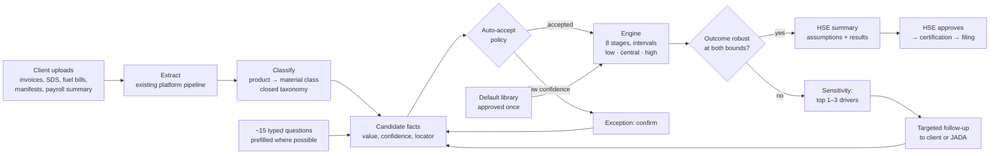
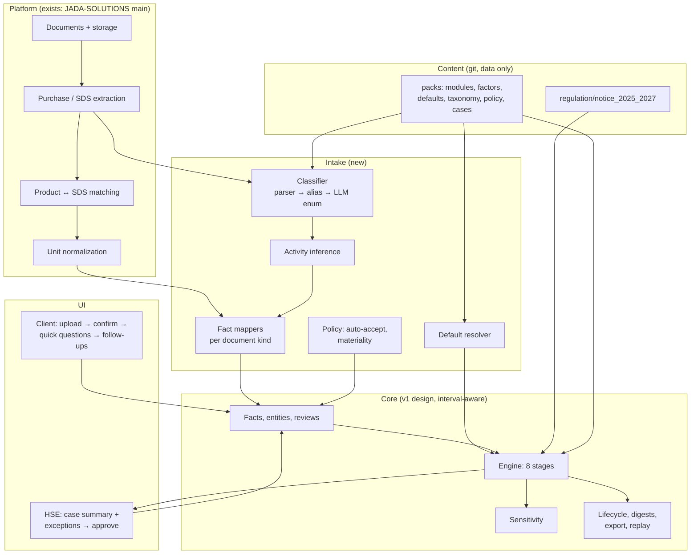
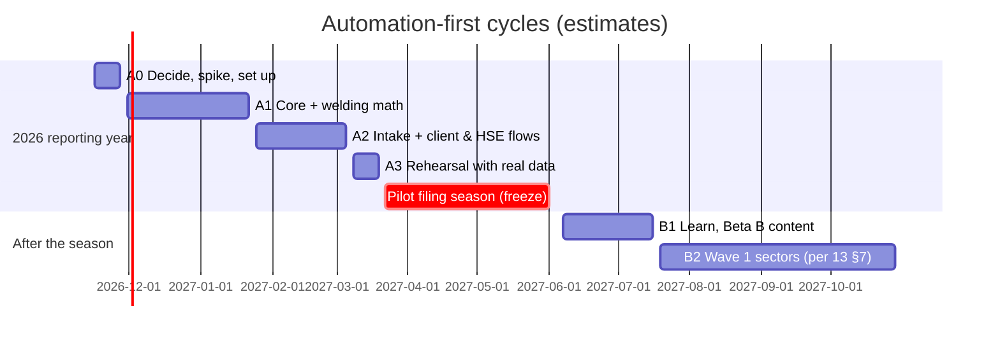

# 00 — Automation-first plan (architecture v2)

Prepared: 2026-11-11. Status: **proposed; supersedes parts of 01–15** (listed in [§20](#20-how-this-plan-changes-documents-0115)). Nothing here has been implemented or approved. No application code, database or client record was changed to write it.

This is the document to build from. Documents 01–15 remain the detailed reference specs for the parts that did not change: the engine stages, calculators, pack format, regulation folder and lifecycle.

---

## 0. Summary

The 2026-11-09 architecture (v1) fixed v0's **shape**: an engine, industry packs and regulation data instead of a 6,000-line evaluator. It kept v0's **attitude**, though. Every uncertainty became a blocker. Every method stayed manual until a practitioner had signed two cases. Every client answer waited for a JADA reviewer. That attitude, not the code size, is why a v0 report would take hours of HSE time.

v2 keeps the v1 structure and changes four things:

1. **Documents in, questions last.** Purchase records, SDS, fuel bills and waste manifests are read by the extraction pipeline JADA already has. The client confirms what was found, answers about 15 typed questions, and never types a fact the software needs into a free-text box.
2. **Assume, flag and move on.** Every input that can be unknown has a sourced default or a conservative bound, approved once as policy. Unknown still never means zero; it means a stated, conservative assumption.
3. **Ask only what can change the answer.** The engine computes low, central and high estimates. When an outcome is the same at both bounds, nobody is asked anything. When it isn't, the system names the one to three inputs that decide it and asks only for those.
4. **Published methods are automatic once they reproduce the official calculator.** The ECCC workbook itself becomes the test oracle, with thousands of generated comparisons. Practitioner time goes into one-time policy and a dozen scenario cases per pack, not per-branch signatures.

**Targets:**

| | Typical shop, first year | Returning year |
|---|---|---|
| Client time | ≤ 45 min | ≤ 15 min |
| HSE technician time | ≤ 30 min median | ≤ 15 min |
| Calculation accuracy | identical to the ECCC calculator on the same inputs | same |

These are design targets. They are not measurements yet: [§14](#14-build-plan) makes them exit gates.

---

## 1. Goals and how each is measured

| Goal | Meaning | Measured by | Target |
|---|---|---|---|
| **Automatic** | The ordinary case needs no human data entry | Share of contributions (by count and by mass) produced without a human-authored fact | ≥ 90% for a typical metal-fab shop at pilot |
| **Fast** | Little human time per report | Timed client and HSE sessions in the product (active time, idle excluded) | Table above |
| **Reliable** | Same inputs give the same result, now and in five years; failures are loud | Replay test; determinism property tests; zero silent zeros; extraction watchdog | 100% replay match; 0 stuck jobs older than 15 min |
| **Accurate** | The numbers equal what the official method gives on the same inputs | Workbook-parity tests ([§8.1](#81-workbook-parity-the-main-accuracy-gate)) and worked examples | 100% of imported rows; exact or 1e-9 relative (Excel float) |
| **Defensible** | Every number traces to a document and a published source | Trace completeness check on every contribution; assumptions listed in the package | 100% |
| **Expandable** | A new sector is mostly data | Code lines per new sector; time from start to first pilot | ≤ 0.5k code lines; ≤ 6 weeks with an anchor client |

What "accurate" means here: published welding factors carry ratings around C–E. The uncertainty of the method is far larger than any rounding difference. The meaningful standard is therefore to **reproduce the official method exactly, and bound the inputs honestly**. JADA and its clients accept small numerical differences between legitimate methods. The software never presents a number as more precise than its inputs.

---

## 2. What changes from v1, and what doesn't

### 2.1 Changes

| Topic | v1 (2026-11-09) | v2 (this plan) | Why |
|---|---|---|---|
| Primary input | Client answers typed questions | Documents are extracted into candidate facts; the client confirms | Clients already have invoices and SDS; typing them is the slow part |
| Free text | Allowed for many questions | Only for "anything else?", "not sure" explanations and comments. Never a carrier of a fact the engine needs. | A free-text answer is a note that someone must re-enter |
| Unknown input | Blocking open item | Policy default or conservative bound, flagged in the package; blocking only if it changes an outcome | Most unknowns don't matter for small shops |
| Fact review | Most client facts need `jada` review | `auto` acceptance under a versioned policy; human review only for exceptions | Reviewing every fact is the main HSE time sink |
| Method gate | `automatic` needs ≥ 2 practitioner-signed cases per branch | `automatic` when the importer is reviewed and workbook parity passes; scenario cases signed once per pack version | Signatures per branch don't scale; the official calculator is a better oracle |
| "Other" electrode | Needs a JADA eligibility fact | System applies workbook Method 1 automatically when the class is not identified, and records why | The workbook recommends Method 1 as the default |
| Quantities | Point values or ranges | Every quantity is an interval (low, central, high); a point value is an interval of width zero | Enables the robustness test |
| Decision gate | Complete inputs, or a pending result | Robust outcome (same at both bounds), with sensitivity-driven follow-up questions | Asks only what matters |
| Open interpretation items (chromium basis, lead qualifier) | Keep Part 1 assessments pending for every stainless shop | Resolve once as policy; until then compute both readings and raise the item only when it changes an outcome | Most shops are far from these thresholds |
| Migration | Strangle v0 with a parity harness (N0 + N1) | Build the core on the platform `main` branch; mine v0 for data and lifecycle code; v0 is not a runtime dependency | v0 has no document-to-fact path, and its 12 factor rows are a weak oracle |
| Custom screens | Five, including the material reconciliation and source-to-outlet map | Two at first: the HSE review summary and the package. The rest are generated or deferred. | Prefilled data and choice questions replace most reconciliation UI |

### 2.2 Unchanged (non-negotiable)

- **Unknown is never zero.** A default is a stated value with a source, or a conservative upper bound. A missing activity never becomes "below threshold".
- **The Notice prevails over the Guide.** Regulation lives in `regulation/notice_2025_2027/`.
- **Human approval, certification and filing stay separate, evidenced events.** The software prepares; the owner or operator certifies.
- **Decimal arithmetic, a full trace and frozen revisions.** Every number points to its document, factor row and calculator version.
- **The engine is deterministic and does no I/O.** An LLM never does arithmetic, selects factors or makes regulatory decisions. It reads documents and suggests classifications into closed lists.
- **Engine, packs and regulation are separate** (v1 ADR-001 to ADR-006 and ADR-008 to ADR-012 stand).

---

## 3. Why this is legally sound

- **Estimation is the normal NPRI method.** The NPRI guidance accepts estimates from published emission factors, mass balances and engineering calculations, and the ECCC welding calculator exists precisely so that shops can estimate without monitoring. The pack uses those methods unchanged.
- **The reporting duty is about reasonably available information.** CEPA section 46 notices require information the person possesses or may reasonably be expected to have access to. They do not require new measurement. *(Confirm the exact wording against S01 when policy is signed.)*
- **Conservative defaults protect the client.** When an input is unknown, the default leans toward over-estimating for threshold decisions. A falsely "not required" result is the costly error. A falsely "required" result is caught by the follow-up loop, because a conservative default that pushes a result over a threshold is exactly the case where the system asks for better data.
- **Disclosure.** The package lists every assumption, default and auto-accepted extraction, so the certifier knows what they are signing.
- **Unchanged responsibility.** Certification remains a human act by an authorized person. Nothing in v2 automates certification or filing.

---

## 4. The automation loop



In words:

1. **Extract** everything the documents contain, with a confidence and a source locator for each value.
2. **Classify** each product into a closed list (electrode class, abrasive type, fuel, coating, solvent …).
3. **Accept** what policy allows. The rest becomes a short confirmation list.
4. **Fill gaps** from the default library, with each use flagged.
5. **Compute** low, central and high estimates for every contribution and assessment.
6. **Test robustness:** is every threshold outcome the same at both bounds?
7. **Ask** only about the inputs that would flip a non-robust outcome, ranked by how much they move it.
8. **Review:** the HSE technician sees one summary of results, assumptions and exceptions, and approves.

The loop usually closes in zero or one follow-up round. A shop far below every threshold produces a no-filing determination with its assumptions listed and no follow-up at all.

---

## 5. Data intake: documents first

### 5.1 What the client is asked to upload

The upload screen is a checklist. Each row has "upload", "don't have this" and "not applicable".

| Document | Feeds | Required? |
|---|---|---|
| Purchase invoices or an ERP or accounting export for the year (consumables, gases, chemicals, paints, abrasives, metal stock) | Material quantities, activity inference | Yes. The single most valuable input. |
| SDS for products used | Composition, density, CAS identities | Yes for chemicals; optional for plain steel stock |
| Natural gas, propane and fuel oil bills | Fuel quantities | Yes if any fuel-burning equipment |
| Waste hauler invoices or manifests | Waste streams and quantities | Optional; asked if a waste stream is material |
| Payroll hours summary, or headcount | Employee-hours gate | Either one |
| Permits, stack tests, lab reports | Measured data; stack facts | Only if they exist |
| Equipment list or photos | Activity confirmation | Optional |

### 5.2 What already exists in the platform (measured 2026-11-11)

The JADA platform (`JADA-SOLUTIONS/backend`, branch `main`) already has most of the intake pipeline. v0 didn't connect its calculations to it.

| Service | File | What it does today |
|---|---|---|
| Purchase extraction | `app/services/extraction/purchase_extractor.py` | LLM tool call returning line items: description, quantity, unit, vendor, date, price, source reference (sheet/row or page), pack size with confidence, year |
| SDS extraction | `app/services/extraction/sds_extractor.py` | Product, manufacturer, substances with CAS and weight-% range, density in kg/L |
| Product ↔ SDS matching | `app/services/matching/product_sds_matcher.py` | LLM match with confidence. Below 0.5 is unmatched, 0.5–0.8 needs review, ≥ 0.8 is auto. |
| Unit normalization | `app/services/normalization/unit_normalizer.py` | Mass in kg from units, pack sizes and SDS density. Issue codes such as `missing_density`, `pack_size_required`, `count_weight_required`, `no_sds_match` and `low_confidence_sds_match`, each with a client or admin review owner. |
| MPO screening | `app/services/mpo/threshold_calculator.py` | Part 1 MPO by CAS with min, mid and max from SDS ranges. It uses a **flat** 10,000 kg reporting and 1,000 kg review threshold. |

The platform therefore already does interval estimates (min/mid/max), confidence tiers and owner-routed review. v2 generalizes those patterns. What it lacks, and v2 adds:

- per-substance thresholds and concentration gating from `substances.json` (Part 1B thresholds are far below 10 t);
- a product classifier;
- activity inference;
- release calculations;
- the connection from all of these into the engine as facts.

### 5.3 Classification: product → material class

Each purchase line or SDS product is classified into a **closed taxonomy** owned by the pack (`material_classes.yaml`):

| Class | Key attributes | Feeds module |
|---|---|---|
| `welding_consumable` | process (SMAW/GMAW/FCAW/SAW/GTAW/PAW), workbook label | `welding_arc`, `welding_tig_plasma` |
| `shielding_gas` | gas type | (no emissions; evidence of GMAW/GTAW) |
| `cutting_fuel_gas`, `oxygen` | gas type | `thermal_cutting` (evidence and activity hints) |
| `thermal_spray_feedstock` | process, alloy | `thermal_spray` |
| `abrasive_media` | media type (sand, slag, steel shot, garnet, glass) | `abrasive_blasting` |
| `coating` | liquid / powder, solvent- or water-borne | `surface_coating`, `powder_coating` |
| `solvent_cleaner` | — | `degreasing` |
| `metalworking_fluid`, `lubricant` | — | `machining_fluids` |
| `metal_stock` | grade (mild steel, 304, 316, aluminum, galvanized) | `thermal_cutting` metals, Part 1 MPO for substrates |
| `fuel` | natural gas, propane, diesel, fuel oil | `boilers_heaters`, `stationary_engines` |
| `not_relevant` | reason | none (office supplies, tools) |
| `unclassified` | — | exception if its mass is material ([§6.4](#64-the-bounding-rule-for-unknown-composition)) |

The classifier runs in three steps:

1. **Deterministic parsers first.** Regular expressions for AWS classifications cover the common patterns: `E6010`, `E7018-1 H4R`, `E308L-16`, `ER70S-6`, `E71T-1C`, `ER4043`, `EM12K`, `ERNiCrMo-3`. A **class map** (`consumable_class_map.csv`) then maps each AWS class to one of the workbook's 47 labels (for example `E7018-1 H4R` → `E7018`; `ER70S-6` → `ER70S/E70S`).
   - Supplemental designators (`-1`, `H4R`, the position digit where the workbook doesn't distinguish) are stripped by explicit rules in the map, not by fuzzy matching.
   - The map is a reviewed data table, approved once by the practitioner and extended as clients bring new classes.
2. **Alias table.** A JADA-maintained table maps trade names to classes. It is seeded from real client data, and every entry is reviewed once (`product_alias.csv`, with reviewer and date).
3. **LLM fallback.** An LLM is asked to pick from the closed enum only. It returns a class, a confidence and the evidence quote (for example the line "7018 1/8in 50lb can"). It can never invent a class, and its output is validated against the enum.

Every classification is a candidate fact with provenance `extracted` or `classified`, the classifier version and the locator of the source line.

### 5.4 Activity inference

Classified materials suggest activities. Electrode purchases suggest P01, abrasive media P08, natural gas P20, powder coating P14. The activity screen is **prefilled with evidence**:

> **Stick or MIG welding — We think yes.** We found 14 invoice lines for welding rod and wire (E7018, E6010, ER70S-6), about 1,150 kg in 2026. [Confirm] [Not us — explain]

Activities with no supporting documents are shown as a grouped checklist: "We found no sign of the following. Confirm none of these happened here, even occasionally." There is a **None of these** button per group, plus individual Yes/Not sure/Done by someone else options.

- This keeps v0's "no all-No defaults" rule. Absence of documents is never treated as absence of an activity. The client makes an explicit, recorded statement, but in one click per group instead of 28 separate screens.
- Specialist activities (plating, hot-dip coating, melting/casting, incineration and other Schedule 3 §1(1)(a) or Part 3 activities) are always asked individually, never grouped.

### 5.5 Candidate facts

Every extracted or classified value becomes a fact version with:

```text
provenance       extracted | classified | derived | default | client | jada | system
confidence       0–1 (extractor or classifier); null for human facts
source_locator   {document_id, page | sheet+row, quote}
producer         extractor/classifier id@version, model id
acceptance       auto (policy id@version) | human (review id) | pending
default_id       when provenance = default
```

These fields extend the v1 fact model ([03 §2.2](03-domain-model-and-facts.md#22-facts-everything-anyone-states)). They are not a separate store.

### 5.6 What the LLM may and may not do

| Allowed | Not allowed |
|---|---|
| Read documents and return values with locators | Do arithmetic that reaches a result |
| Pick a class from a closed list, with confidence | Choose a factor, method or regulatory outcome |
| Suggest activities from G17 free text, for JADA to confirm | Accept its own suggestion |
| Draft plain-language explanations of results | Change a number in an explanation |

The model ID and prompt version are recorded on every extraction. Re-extraction happens only on request, never silently, so a filed revision's inputs never change underneath it.

---

## 6. The default library

### 6.1 The data ladder

Every input the engine needs has an ordered ladder of acceptable data. The engine uses the highest rung available, and every rung below "records" is flagged in the package.

```text
1. measured            (stack test, meter, lab result)
2. records             (invoices, inventory, logs, bills)
3. supplier data       (SDS, TDS, certificate of analysis)
4. client estimate     (typed number or chosen band)
5. published default   (ECCC workbook, AP-42, ECCC guide value)
6. policy default      (JADA conservative value, approved once)
```

### 6.2 Default entry format

```yaml
# packs/shared/welding_arc/defaults.yaml
- id: welding_arc.class_unknown.method1
  applies_to: P01-2.class                       # the fact it fills
  when: {fact: P01-2.class, state: unknown}
  use: {binding: arc-other-method1-v1}          # workbook "Other <process>" Method 1 rows
  basis: published_default
  source: {id: S05, locator: "Instructions!A68–A86"}
  flag: "Electrode class not identified in records; workbook Method 1 average factors used."
  direction: central                            # not deliberately conservative; the workbook's recommended default
  approved: {by: "<HSE practitioner>", date: null, policy: metal_fab-policy@1}
```

Defaults are data, versioned with the pack, and approved once each. A default without approval cannot be used by an `auto` path. In that case the input stays an exception.

### 6.3 Starter default set for `metal_fab` (proposed; each needs one-time approval)

| Input | Default | Basis | Notes |
|---|---|---|---|
| Electrode class unknown, process known | Workbook "Other <process>" Method 1 | Published (S05 Instructions) | Replaces v1's JADA eligibility fact |
| Welding process unknown | "Other Welding Methods" Method 1 | Published (S05) | Flagged |
| PM2.5 from welding | 0.75 × PM10 | Published (S05 `Instructions!A61`) | v1 import assumption, approved once |
| TPM from welding | = PM10 | Published (S05 `Instructions!A60`) | Same |
| Annual use, stock change unknown | central = purchases in year; bounds = purchases × (1 ± `stock_uncertainty`) | Policy | `stock_uncertainty` is a policy parameter (proposed 25%) |
| Capture or control unknown | Uncontrolled | Published factors are uncontrolled (S05 `Instructions!A63`) | Conservative |
| Air outlet unknown | General building exhaust, not an individual stack | Policy | Stack status is asked by one yes/no question ([§10.3](#103-the-core-questions)) |
| Active cutting time unknown | **Derived from consumables** (discs, plasma electrodes, gouging carbons, gas volume) with approved ranges; a band answer only if the derivation is sensitive or there are no consumable records | Records + policy parameters | See [16 §6](16-welding-workbook-spec.md#6-activity-derivation-getting-the-workbooks-inputs-from-documents) |
| Base-metal composition for cutting metals | Grade specification range (for example 304: Cr and Ni ranges from the grade standard) | Published standard | Reviewed table `metal_grades.csv` |
| Employee hours, only headcount known | headcount × `fte_hours` (central), with bounds | Policy | `fte_hours` proposed 2,080, bounds 1,800–2,300 |
| Natural gas HHV unknown | Bill energy content if printed; otherwise AP-42 reference HHV | Records / published | v0 `fuel_combustion` reference |
| SDS gives a % range | low = min, central = midpoint, high = max | Supplier data | Same as the platform's min/mid/max |
| Product has no SDS and is unclassified | Bounding rule (§6.4) | Policy | Exception only if the bound matters |

### 6.4 The bounding rule for unknown composition

When the composition of a product is unknown, its whole mass is an upper bound for any substance in it. If the total mass of all such products in the year is below the lowest threshold it could affect, it can't change any outcome, and no question is needed.

> 3 kg of an unidentified aerosol cannot reach even a 5 kg Part 1B threshold, so it is closed as "bounded, cannot affect any threshold" and listed in the package.

Concentration conditions on Part 1 thresholds only make the bound more conservative, because the bound ignores them. The rule is exact, needs no data and closes most of the "we don't have the SDS" cases for small quantities.

### 6.5 Never defaulted (always a person)

| Item | Why |
|---|---|
| Presence of Schedule 3 §1(1)(a) or Part 3 activities (incineration, wood preservation, smelting, …) | They change applicability by themselves, regardless of quantity |
| Specialist surface treatment with hexavalent chromium, hot-dip coating, melting or casting | Methods are case-specific |
| Stacks 25 m or taller, when Part 4 is met | Stack reporting is per stack and needs real data |
| Spills, fires, upsets and control outages | Events, not averages |
| Ownership changes, closures and the reporting period | Legal facts |
| Certification and filing | Human acts |

---

## 7. Materiality: the robustness test and the exception queue

### 7.1 Intervals everywhere

Every quantity in the engine is an interval `(low, central, high)`. A point value has `low = central = high`. Calculators propagate intervals:

- monotone math (activity × factor, composition) uses `low × low` and `high × high`;
- subtraction in mass balances uses `in.low − out.high` for the low bound and `in.high − out.low` for the high bound;
- a negative low bound on a balance residual is clamped to 0 **only for the bound**, and is flagged.

The **central** value is what gets reported when a report is required. The bounds exist for decisions.

### 7.2 Outcome classes

For each threshold assessment with threshold *T*, a margin *m* (policy) and the facility's aggregate interval:

| Condition | Outcome | Human action |
|---|---|---|
| `high < T × (1 − m)` | **not met (robust)** | None. Listed in the summary. |
| `low ≥ T` | **met (robust)** | None for the decision; reporting outputs follow |
| `T × (1 − m) ≤ high` and `low < T` | **sensitive** | System runs sensitivity and asks targeted follow-ups |

`m` is a policy parameter, proposed at 0.2 (auto "not met" only when even the high estimate is more than 20% below the threshold). The legacy platform's 1,000 kg review band on a 10,000 kg threshold is the same idea.

### 7.3 Sensitivity: which inputs to ask about

For a sensitive assessment, the engine re-evaluates stages 3–6 with each uncertain input moved to its bounds, one at a time, the others at central. Inputs are ranked by how much they move the aggregate.

The follow-up asks for the **smallest set of top-ranked inputs whose resolution could make the outcome robust**, usually one to three. Each follow-up is phrased with its reason:

> Manganese from welding could be close to the reporting threshold. The biggest uncertainty is how much 7018 rod you had in stock at the start and end of 2026. Can you check?

This is cheap. One facility has tens to hundreds of contributions, and each re-evaluation takes milliseconds. It lives in `core/engine/sensitivity.py` as a pure function that calls the pipeline repeatedly, so the stages stay unchanged.

### 7.4 Auto-acceptance policy

`policy.yaml` is versioned per pack and approved once by the practitioner:

```yaml
# packs/metal_fab/policy.yaml
id: metal_fab-policy
version: 1
materiality_margin: 0.2
stock_uncertainty: 0.25
fte_hours: {central: 2080, low: 1800, high: 2300}
auto_accept:
  extracted:            {min_confidence: 0.9, validators: pass}
  classified:           {min_confidence: 0.9, source: [parser, alias_table]}
  classified_llm:       {min_confidence: 0.95}
  client_answer:        {review: none}           # client answers are accepted as the client's statement
  default:              {requires: approved}
exceptions_always:
  - schedule3_activity_present
  - specialist_process_present
  - stack_ge_25m_and_part4_met
  - incident_reported
  - ownership_change
human_spot_check:
  sample_auto_accepted_facts: 3                 # per report, shown in the HSE summary
approved: {by: null, date: null}
```

A fact accepted by policy records `acceptance: auto (metal_fab-policy@1)`. If an auto-accepted fact turns out to drive a sensitive outcome, its acceptance is **escalated**. It moves into the exception queue for a human, because a fact that decides a result deserves a person's look.

### 7.5 Exception types

| Exception | Owner | Typical frequency (estimate) |
|---|---|---|
| Low-confidence extraction or classification of a material product | client confirm, else JADA | 0–5 per report |
| Sensitive outcome follow-up | client | 0–2 |
| `unclassified` product above the bounding limit | client (SDS request) | 0–2 |
| Always-exception item (§6.5) | JADA | 0–1 |
| Interpretation item that changes an outcome (chromium basis, lead qualifier, I03, I04) | practitioner | Rare |
| Unsupported branch reached (no automatic or manual path) | developer | Rare; blocks |

The target is **five or fewer exceptions** on a typical report.

### 7.6 Open interpretation items become conditional

v1 kept every stainless-welding Part 1A chromium assessment pending until the chromium basis question (v1 Q2) was answered. In v2:

1. The engine computes the contribution under both readings (total chromium and non-hexavalent).
2. If the outcome is the same under both, the item is not raised for that case. The package notes that the outcome doesn't depend on it.
3. If it differs, a `practitioner` item is raised for that case.
4. Once the practitioner decides as policy, the choice becomes a data row and both readings collapse to one.

The same applies to the lead qualifier and the I03/I04 stack holds. **Open questions block only the cases where they matter.**

---

## 8. Accuracy: verification without per-branch signatures

### 8.1 Workbook parity (the main accuracy gate)

The ECCC workbook is the official calculator, so it is the strongest independent oracle available. The plan uses it directly.

1. `jada-pack import` reads the workbook's formulas and writes the factor CSVs, as in v1 ([08 §3](08-welding-pack-design.md#3-importing-the-full-eccc-workbook)).
2. `jada-pack parity` generates input sets: every workbook label × method variant × a spread of quantities (0, small, typical, large, maximum-precision Decimals). It writes each set into the workbook's input sheets.
3. The workbook is **recalculated headless**, with LibreOffice (`soffice --headless` with a recalculation macro) or a formula engine (`formulas` or `pycel`). The outputs are read back.
4. The same inputs run through the engine, and the outputs are compared.
   - The comparison is exact when both are exact.
   - Otherwise it uses a relative tolerance of 1e-9, which is enough to absorb Excel's binary floats and nothing else.
5. A branch is `automatic` when:
   - its rows' importer manifest is reviewed;
   - parity passes for every row it can select;
   - its default entries are approved.

Generated parity cases number in the thousands and cost no practitioner time. They catch transcription errors, unit errors, wrong conditional variants (Method 1 vs 2) and PM2.5 derivation errors. These are exactly the mistakes a hand-transcription makes.

The full calculation specification is the extracted guide `documents/guidelines/official/electric-arc-welding-cutting-and-spraying-calculation-guide.md`. JADA decided on 2026-11-12 that the workbook is the reference and the engine follows its formulas as written (D10). How that maps to the engine, and how the workbook's inputs are derived from documents, is in [16 — Welding workbook reproduction and activity derivation](16-welding-workbook-spec.md).

Method 2 is the workbook's composition-weighted approach (`Input Arc Welding (Method 2)!P4:Z11`). v1 marked it a manual verification task. With parity, its formulas are exercised directly, so Method 2 becomes automatic as soon as parity passes.

**Spike first.** Headless recalculation of this specific workbook is the riskiest technical assumption in the plan. It is the first task of cycle A0 ([§14](#14-build-plan)). If LibreOffice can't recalculate it faithfully, the fallback is a Python formula engine. If that fails too, the fallback is about 50 cells recalculated by hand in Excel by the practitioner and frozen as fixtures.

### 8.2 Worked examples for the other calculators

Combustion, blasting and mass-balance calculators keep v1's acceptance fixtures ([05 §7](05-calculators-and-factors.md#7-calculator-acceptance)). These are AP-42 or ECCC worked examples plus hand-worked arithmetic. Where ECCC publishes a spreadsheet calculator for a method (blasting, combustion), the same parity approach applies.

### 8.3 Scenario cases (signed once per pack version)

About 12 whole-facility scenarios per pack are signed by the practitioner. They check **regulatory logic and wiring**, not arithmetic, which parity already covers. For metal_fab they are v1's f01–f11 plus one mixed-shop case:

- discovery and the robustness rules;
- the defaults used;
- Part decisions, the no-filing determination, DNMC and the destinations ledger.

They are the release gate for a pack version, instead of two signed cases per branch.

### 8.4 Regulation boundary cases

v1's ~60 boundary fixtures (below, equal and above thresholds; ranges; qualifiers; facility cases) stay as they are ([10 §3](10-golden-cases-and-verification.md#3-kinds-of-cases)). They test rule functions, are independent of packs, and are written once per notice.

### 8.5 Extraction accuracy

Extraction is now a dependency of correctness, so it is measured like one:

- **A labeled evaluation set** from real, consented client documents: about 300 invoice lines across 5+ vendors, 60 SDS, 20 fuel bills and 10 waste manifests, with ground truth entered by a person.
- **Per-field metrics:** precision and recall for quantity, unit, pack size, CAS, % range, density, class and date.
- **Calibration:** the `min_confidence` values in `policy.yaml` are set from this data. Confidence 0.9 must mean at least 98% correct on the evaluation set, or the threshold rises.
- **Re-run** on any change of model, prompt or extractor version. A regression blocks the release.
- **Field targets** (proposed): quantity and unit ≥ 98% on auto-accepted lines; class ≥ 98% on auto-accepted lines; CAS ≥ 99%.

### 8.6 Sanity bands

Each result is compared with the distribution of NPRI public data for similar facilities (same NAICS group and similar size). An outlier (for example PM10 per employee hour ten times the typical value) is shown in the HSE summary. Sanity bands are **advisory**. They never change a number or block a report; they are there to catch a misread unit.

### 8.7 Invariant and property tests

These are kept from v1 ([04 §7](04-engine-pipeline.md#7-testing-the-engine)) and extended:

- determinism;
- unknown never becomes zero;
- adding an unrelated entity never changes an unrelated assessment;
- widening any input interval never turns a robust "met" into "not met", or vice versa, without passing through "sensitive";
- the bounding rule is never applied to a product with a known composition.

---

## 9. Architecture v2

### 9.1 Layers



### 9.2 What is reused from v1 unchanged

| v1 doc | Kept as specified |
|---|---|
| [02](02-architecture-overview.md) | Layers, rules 1–4 and 6, dependency boundaries, technology choices, non-goals (no runtime LLM in arithmetic) |
| [03](03-domain-model-and-facts.md) | Entities, facts, dependency digests, engine-side records, persistence; extended by §5.5 and §9.3 |
| [04](04-engine-pipeline.md) | The eight stages, their order and determinism rules; quantities become intervals (§7.1) |
| [05](05-calculators-and-factors.md) | Calculator contract, registry, factor selection outcomes, factor-table contract, units |
| [06](06-pack-format-spec.md) | Pack and module format, routing grammar, versioning; extended by §9.4 |
| [07](07-regulation-as-data.md) | Regulation folder, rule library, holds as data, obligations and filing fields |
| [11](11-lifecycle-freshness-and-replay.md) | Lifecycle states, run pinning, freshness, re-pinning, replay, export, carry-forward |

### 9.3 Changes to the core model

| Element | Change |
|---|---|
| `Fact` | Adds `confidence`, `source_locator`, `producer`, `acceptance`, `default_id` (§5.5). New `provenance` values: `classified`, `default`, `system`. |
| `Quantity` | Interval `(low, central, high)` with the unit; point values have width zero |
| Question `review` policy | `auto` (policy decides), `exception` (human only when flagged), `human` (always, independent where stated), `practitioner`. Replaces v1's `none / jada / independent / practitioner`. |
| `OpenItem` | Adds `materiality` (`decisive`, `not_decisive`), `drivers[]` and `ask_text`. Only `decisive` items block approval, plus the always-exception kinds. |
| `Assessment` | Adds `interval`, `robustness` (`robust_met`, `robust_not_met`, `sensitive`) and `drivers[]` |
| `Contribution` | Adds `assumptions[]` (default IDs used) for the package's assumptions list |
| Stage 8 readiness | `can_approve` requires: no `decisive` items, no always-exception items open, every assessment robust or resolved by a human decision, and the remaining v1 conditions |

### 9.4 Additions to the pack format

```text
packs/
  shared/<module>/
    module.yaml          + prefill:   (fact ← intake mapper paths)
                         + bands:     (band definitions for band questions)
    defaults.yaml        NEW  (§6.2)
    factors.csv
    cases/
  metal_fab/
    pack.yaml
    policy.yaml          NEW  (§7.4)
    material_classes.yaml NEW (§5.3 taxonomy)
    consumable_class_map.csv NEW (AWS class → workbook label)
    product_alias.csv    NEW
    metal_grades.csv     NEW
    import/              (workbook manifests, unchanged)
    parity/              NEW (generated parity case specs; outputs are not committed)
    cases/               (~12 scenario cases)
```

`prefill` example:

```yaml
prefill:
  - fact: P01-2
    from: intake.materials
    where: {class: welding_consumable}
    map: {process: attrs.process, class: attrs.workbook_label, mass: mass_kg, basis: "purchased_adjusted"}
    group_by: [attrs.process, attrs.workbook_label]
```

The mapper is generic code. Each module only declares what it wants. A new module needs no new intake code unless it needs a new document kind.

### 9.5 New question types

| Type | Renders as | Use |
|---|---|---|
| `band` | A choice of ranges, for example "under 100 h · 100–500 h · 500–2,000 h · over 2,000 h · don't know" | Fast estimates. The engine uses the band's bounds, and asks for an exact number only if the outcome is sensitive. |
| `confirm_prefill` | The prefilled value with its evidence, and Confirm / Correct / Not us | Every prefilled fact |
| `checklist_none` | A group of activities with "None of these" and per-item answers | Activities without evidence (§5.4) |

The other v1 types stay (screen, choice, quantity, period, text, entity reference, table, file).

### 9.6 Simplifications vs v1

- **Review policies:** four simpler ones, with most facts `auto`.
- **Custom screens:** two at first, the HSE case summary and the package/lifecycle screen. The material reconciliation and source-to-outlet screens are deferred until a pilot shows they are needed. For a typical shop, prefilled purchases and three choice questions replace them.
- **v0 parity harness:** no longer a gate. v0's 12 rows are still reproduced as a smoke check, because the workbook import covers them.
- **Golden cases:** about 12 scenario cases per pack instead of about 70 module cases plus 18 facility cases. Parity and boundary cases carry the rest.
- **Parked features:** EGU, prior-year comparison and the low-hours oil-and-gas UI stay parked as in v1.

---

## 10. Client journey and the new questionnaire

### 10.1 Flow and time budget (first year, typical shop)

| Step | Screen | What happens | Client time (estimate) |
|---|---|---|---|
| 1 | Facility and year | Prefilled from the account and facility record; NPRI ID looked up from public NPRI data by address | 2 min |
| 2 | Upload | Checklist of document kinds (§5.1), drag and drop, "don't have this" per row | 10–15 min |
| — | (processing) | Extraction, classification, prefill: minutes, with progress shown | — |
| 3 | What we found | Prefilled activities with evidence; grouped "none of these"; specialist activities asked one by one | 3–5 min |
| 4 | Quick questions | About 15 typed questions, most prefilled (§10.3) | 5–10 min |
| 5 | Confirm a few items | Low-confidence extractions (if any) as confirm/correct cards | 0–5 min |
| 6 | Follow-ups | Only if an outcome is sensitive: one to three targeted questions | 0–10 min |
| 7 | Submit | Preview: "Likely no NPRI report required" or "A report is likely required for …", with "JADA will confirm" | 1 min |

The first-year total is about 25–45 minutes. In a returning year, the structure carries forward as confirmation candidates ("Same equipment and activities as 2026?") and the client uploads the new year's records, so the estimate is 10–15 minutes.

### 10.2 What happened to G01

G01 ("What is the name and address of the location…") disappears as a question. The facility record already holds name, address, city, province, postal code and coordinates. The client sees them prefilled, with one **Confirm** button and a link to edit. The only new information G01 asked for, attached buildings and outdoor areas, becomes one yes/no: "Does this location include other buildings or outdoor work or storage areas?" If yes, a short table follows.

### 10.3 The core questions

| # | Replaces | Question | Type | Prefilled from |
|---|---|---|---|---|
| Q1 | G01 | Confirm facility name and address | `confirm_prefill` | Facility record |
| Q2 | G01 | Other buildings or outdoor work/storage areas at this location? | screen, then table | — |
| Q3 | G02 | Did you operate here all of 2026, under the same owner? | yes / no + dates | — |
| Q4 | G03 | NPRI ID / reported last year? | `confirm_prefill` | NPRI public data lookup |
| Q5 | G04 | Main business | choice (NAICS short list) | Account, NPRI data |
| Q6 | G05 | Employee hours in 2026 (including overtime, vacation, sick leave) | quantity, **or** headcount, **or** band | Payroll upload |
| Q7 | G05 | Contractors or owners working on site, not on payroll? | `band` | — |
| Q8 | G06 | Activities | `confirm_prefill` + `checklist_none` | Activity inference |
| Q9 | G07 | Did equipment or activities change during 2026? | yes / no, then short table | — |
| Q10 | G09 | Do your 2026 purchases roughly equal what you used? | choice: about the same / built up stock / used up stock / don't know | — |
| Q11 | G10 | Where do welding fumes and dust go? | multi-choice: stay indoors / wall or roof fans / portable extractors / central collector / booth with filters | — |
| Q12 | stack | Any stack or vent 25 m or taller? | yes / no / not sure | — |
| Q13 | G11 | Which wastes leave the site? | multi-choice: scrap metal, spent abrasive, filters/dust, waste paint/solvent, used oil, other | Waste invoices |
| Q14 | G12 | Is water used in processes or exposed to materials outdoors? | yes / no / not sure | — |
| Q15 | G13 | Permits or test reports that measure emissions, water or waste? | yes / no, then upload | — |
| Q16 | G14 | Spills, fires, unusual releases or filters off for long periods? | yes / no, then short table | — |
| Q17 | G16 | Who can answer questions and who certifies? | `confirm_prefill` | Account users |
| Q18 | G17 | Anything else we haven't asked about? | yes / no + text | — |

**Asked only when needed:**

| Question | When | Replaces |
|---|---|---|
| G15, pollution-prevention plan | A report is required | G15 |
| Previous filing details and corrections | Q4 says the facility reported before | G03 detail |

**Module questions** appear only for confirmed activities, and only for inputs that documents didn't supply. Examples:

| Module | Question | Type | Usually prefilled? |
|---|---|---|---|
| Welding (P01) | Consumables by class and mass | `confirm_prefill` table | Yes, from invoices |
| Welding (P01) | Hardfacing done? | yes / no | — |
| Cutting (P05) | Which cutting methods? | multi-choice: oxy-fuel, plasma, laser, arc gouging | Gas purchases suggest |
| Cutting (P05) | Hours actually cutting per year | `band` | — |
| Cutting (P05) | Metals cut | multi-choice by grade | Metal stock invoices |
| Blasting (P08) | Media and tonnes | `confirm_prefill` | Yes |
| Blasting (P08) | Indoors in a cabinet or room, or outdoors? | choice | — |
| Coating (P13/P14) | Products and quantities | `confirm_prefill` table | Yes, from invoices and SDS |
| Combustion (P20) | Fuel quantities | `confirm_prefill` | Yes, from bills |
| Combustion (P20) | Which equipment burns it? | multi-choice: space heaters, boiler, oven, generator, other | — |

A typical welding-and-cutting shop sees about 18 core questions and 6–10 module questions. Most are one-click confirmations.

### 10.4 Where plain language still appears

| Place | What is done with it |
|---|---|
| Q18 "anything else" | Read by JADA. An LLM may **suggest** activities from it, shown to the HSE technician as "the client mentioned X; consider P27". Never auto-accepted. |
| "Not sure" explanations | Shown to JADA with the item |
| Comments on any answer | Shown to JADA; not used by the engine |

Answers to the questions above are typed. So the question "how does plain text become a fact?" has the answer **it doesn't need to**: facts come from documents and typed answers, and text is context for a person.

---

## 11. The HSE technician's workflow

### 11.1 The case summary screen (one page)

1. **Header:** facility, year, pack and policy versions, client completion time, last run.
2. **Decision table:** each relevant Part and substance with a bar showing low–central–high against the threshold. Robust results are grey, sensitive ones amber, met ones blue. Click to open the trace.
3. **Exceptions:** items that must be resolved, each with the deciding evidence inline and one-click actions. These are the only blocking items.
4. **Assumptions:** the defaults used, grouped. Example: "Stock change unknown → purchases used (6 products)" and "Electrode class unknown → Method 1 (2 lines)". One acceptance for the group, or open one to change it.
5. **Spot check:** three randomly sampled auto-accepted facts with their source snippets. The technician confirms or corrects them, which keeps auto-acceptance honest and feeds calibration.
6. **Advisories:** sanity-band outliers, year-over-year changes against last year's JADA report or public NPRI data, and G17 text.
7. **Actions:** return to client (with precise items), create a revision, approve.

### 11.2 Time budget

| Activity | Time (estimate) |
|---|---|
| Read the decision table | 3–5 min |
| Resolve exceptions (≤ 5) | 5–15 min |
| Review assumption groups | 3–5 min |
| Spot check (3 facts) | 2–3 min |
| Advisories | 1–3 min |
| Approve, hand off for certification | 1–2 min |
| **Total** | **15–33 min** (median target 30, returning year 15) |

The product records active time per case. That measurement is the real check of this plan, and it is an exit gate of cycle A3.

---

## 12. Expandability: adding a sector in v2

The v1 playbook ([14](14-adding-an-industry.md)) still applies. v2 adds four content items per sector and removes per-branch signatures:

| Step | v1 | v2 |
|---|---|---|
| Process inventory | Practitioner | Same |
| Special rules | Practitioner + developer | Same |
| Calculator gaps | Developer | Same |
| Factor import | Manifests | Manifests **plus parity** against each ECCC spreadsheet calculator for the sector, where one exists |
| Questions | Typed questions per module | Typed questions, **plus `prefill` and `bands`** |
| Taxonomy | — | **New:** extend `material_classes.yaml` (for example aggregates and explosives for pits and quarries; inks for printing) |
| Defaults | — | **New:** `defaults.yaml` per module, approved once |
| Policy | — | **New:** a `policy.yaml` per pack, usually copied from metal_fab with sector-specific always-exceptions |
| Golden cases | 2–5 per module plus facility cases | About 10–12 scenario cases per pack |

Reused across all sectors without change:

- the intake pipeline;
- the robustness test and sensitivity;
- the HSE summary screen;
- the bounding rule;
- the auto-accept machinery.

Those are where most of the speed comes from, and they are sector-neutral.

**Pits and quarries, re-estimated:** about 4 weeks instead of 6. The playbook steps are the same, but there are fewer signed cases and the production question can be prefilled from scale-house reports.

---

## 13. Reliability and operations

| Concern | Design |
|---|---|
| Determinism and replay | Unchanged from v1 ([11 §5](11-lifecycle-freshness-and-replay.md#5-replay)). Extraction outputs are frozen as facts, so replay never re-extracts. |
| Model changes | Model ID and prompt version are pinned per extractor version. A model upgrade is a new extractor version that must pass the extraction evaluation set (§8.5) before use. |
| Stuck jobs | Watchdog: any extraction job in `extracting` longer than 15 minutes is re-queued once, then marked failed with a visible error. The reason is the preview incident during this planning work: SDS files sat in "processing" because the macOS prefork worker pool crashed on every task. Dev setup uses `--pool=threads` on macOS. |
| Reporting-year handling | Years come from the notice registry: a year is offered only if a released pack exists for it. The v0 preview showed a facility page offering 2025 while the workspace accepted only 2026, so no year literal appears in the UI code. |
| Cost | LLM cost is recorded per report (the platform has `extraction/cost.py`). Target, to be measured: under a few dollars per report. |
| Privacy | Client documents go to the LLM provider. The client agreement must say so, and documents are processed under the provider's data terms. This needs a JADA decision (§17). |
| Failure display | A failed extraction, classifier or engine error is a visible exception with a retry, never a silent gap. A run with an engine error never shows a partial green state (v1 rule). |

---

## 14. Build plan

### 14.1 Assumptions

- **Team:** the JADA developer (you) with AI coding agents, plus a part-time HSE practitioner (about 0.3–0.5 FTE). Scale the dates if capacity differs.
- **Base:** a new branch from platform `main` (`ca29307`) in `JADA-SOLUTIONS/backend`, and the same for the frontend. v0's branch `codex/welding-npri-v0` is committed as is for reference, and mined by copy.
- **Fixed point:** 2026 data is due **June 1, 2027**.

### 14.2 Timeline



### 14.3 A0 — Decide, spike, set up (16–27 Nov 2026)

| Work | Done when |
|---|---|
| JADA accepts this plan's direction and the §17 decisions that are needed now | Decisions recorded in [15](15-decisions-risks-open-questions.md) |
| **Workbook recalculation spike:** LibreOffice headless, then the `formulas` or `pycel` fallback | Recalculating 20 hand-picked input sets reproduces values the practitioner computed in Excel |
| Commit v0 as is on its branch (no fixing), so nothing is lost | v0 branch has a reviewed commit; no further v0 work planned |
| Create the `npri-core` branch and skeleton (§15); content loader; CI with the boundary check | `jada-pack validate` runs on an empty pack |
| Copy regulation data from v0: `substances_2026.json`, obligations, filing fields, `elemental_metal_cas_2026.json` | Loads into `regulation/notice_2025_2027/` and validates |
| Start the extraction evaluation set: collect consented documents from 2–3 past clients | 100+ invoice lines and 20 SDS labeled |
| Practitioner drafts `policy.yaml` values and reviews the starter defaults (§6.3) | Draft signed off for development use |

**Exit gate:** the spike result is known, and the plan's direction is accepted.

### 14.4 A1 — Core and welding math (30 Nov 2026 – 22 Jan 2027, about 6 working weeks)

| Week | Work |
|---|---|
| 1 | Fact, entity and review model with the v2 fields; interval `Quantity`; generic authorization by question owner |
| 1–2 | Calculators `activity_x_factor@1`, `composition@1`, `mass_balance@1`, `fuel_combustion@1`, `manual@1`, all interval-aware, with acceptance fixtures |
| 2–3 | Stages 1–8 (port from v0 where v1 says so: thresholds, aggregation, facility cases); rule functions |
| 3 | `jada-pack import` for the full workbook (welding, cutting, spraying); class map; substance map |
| 3–4 | `jada-pack parity` generating cases and comparing |
| 4–5 | Default resolver, robustness classification, `sensitivity.py` |
| 5–6 | Lifecycle reuse from v0 (digests, projection, export with content and assumptions appendix); replay test |
| 1–6 | Practitioner: review the import manifest and substance map; write scenario cases f01–f05 |

**Exit gate:**

- workbook parity passes for 100% of imported rows across all method variants, including Method 2;
- v0's 12 rows are reproduced;
- the blasting and natural-gas fixtures match;
- the property tests pass, including "widening never flips without sensitive";
- no engine file is over about 400 lines;
- the replay test passes.

### 14.5 A2 — Intake, client flow and HSE flow (25 Jan – 5 Mar 2027, 6 weeks)

| Week | Work |
|---|---|
| 1 | Classifier (parser, alias table, LLM enum); per-module `prefill` mappers; activity inference |
| 1–2 | Fuel bill extraction (a new document kind using the existing LLM client); payroll and headcount question |
| 2–3 | Client flow: upload checklist → what we found → quick questions → confirm cards → follow-ups → submit |
| 3–4 | HSE case summary screen; exception queue; spot check; return to client |
| 4 | Remaining metal_fab modules: blasting, natural-gas combustion, solvent and coating balances automatic; the rest manual-supported with the generic `manual_result` editor |
| 5 | Extraction evaluation run and calibration of `policy.yaml` confidence values |
| 5–6 | Scenario cases f06–f12 signed; browser journeys on desktop and mobile; security regression (kept v0 tests) |

**Exit gate:**

- the extraction targets in §8.5 are met on the evaluation set;
- 12 scenario cases are signed;
- the client flow runs end to end on 3 synthetic shops;
- no free-text answer is read by the engine (a CI check on question types).

### 14.6 A3 — Rehearsal with real data (8–19 Mar 2027)

- Run 2–3 past clients' real 2025 or 2026 documents through the system.
- The practitioner independently produces a hand estimate for each, using the ECCC workbook directly.
- Time the client flow (staff acting as the client) and the HSE review.

**Exit gate:**

- engine results equal the practitioner's workbook estimate on the same accepted inputs;
- every decision matches;
- median HSE time is ≤ 30 minutes and client time ≤ 45 minutes;
- if a target is missed, the cause is listed and fixed before the pilot, or the target is consciously revised.

### 14.7 Pilot filing season (22 Mar – 1 Jun 2027)

v1's N3 rules stay:

- feature freeze;
- content fixes allowed;
- every override and manual result logged with its reason.

Added in v2:

- per-case timing;
- exception counts by type;
- spot-check correction rate (above 2% wrong means the auto-accept thresholds rise).

### 14.8 After the season

- **B1 (Jun – mid-Jul):** turn the override log into content and cases. Promote remaining manual families where pilots showed demand: coating, process chemicals, powder coating, more fuels.
- **B2 onward:** Wave 1 sectors as in [13 §7](13-delivery-cycles.md#7-n4--wave-1-packs-general-manufacturing-and-food-jun--aug-2027-10-weeks), using the v2 playbook (§12). Then the N5 calculators and the later waves as in 13.

---

## 15. Repository layout

Backend, on the new branch:

```text
backend/
  app/                         # existing platform (unchanged structure)
    api/ models/ services/ tasks/
    services/extraction/       # existing: purchase, SDS (+ new: fuel_bill)
  npri/                        # NEW: everything in this plan
    core/
      types/                   # Quantity (interval), FactorRow, Fact, OpenItem, ...
      units.yaml
      calculators/             # activity_x_factor, composition, mass_balance, fuel_combustion, manual
      rules/                   # rule functions (from v0 thresholds/facility_cases/rules)
      engine/
        pipeline.py
        stages/                # scope, discover, calculate, reconcile, aggregate, assess, obligations, readiness
        sensitivity.py
      facts/                   # fact model, review policies, auto-accept, digests
      lifecycle/               # from v0: digests, projection, export, content store
      defaults/                # default resolver
    intake/
      classifier/              # parser.py, alias.py, llm_enum.py
      mappers.py               # generic prefill mapper
      activity_inference.py
    services/                  # workspace, evaluate (bundle building), lifecycle
    api/                       # ~25 routes (v1 09 §8) + intake routes
    tools/jada_pack/           # validate, test, import, parity, diff, explain
  content/
    regulation/notice_2025_2027/
    packs/shared/...  packs/metal_fab/...
  tests/npri/                  # hand-written tests (~8k target); generated parity outputs are not committed
```

Frontend:

```text
frontend/src/npri/
  renderer/                    # question types incl. band, confirm_prefill, checklist_none
  client/                      # upload, found, questions, confirm, follow-ups, submit
  hse/                         # case summary, exceptions, spot check
  lifecycle/                   # package (reused v0 patterns)
```

---

## 16. Work breakdown for agents

Each slice is one task for a coding agent: one pull request of about 1–3k lines, reviewed and committed before the next slice that depends on it. Line counts are estimates.

| ID | Slice | Depends on | Done when | Size |
|---|---|---|---|---|
| S01 | Workbook recalculation spike (script + findings note) | — | §14.3 spike criterion | 0.3k |
| S02 | `npri/` skeleton, content loader, JSON Schemas, CI boundary check | — | `jada-pack validate` on empty content | 1.2k |
| S03 | Regulation folder from v0 data + validators | S02 | Loads; cross-references checked | 0.8k + data |
| S04 | Interval `Quantity`, unit table, Decimal context | S02 | Property tests for interval arithmetic | 0.6k |
| S05 | Fact/entity/review tables, migrations, v2 fields, owner authorization | S02 | API tests: create, version, review, auto-accept | 2.0k |
| S06 | Calculators ×5 with fixtures | S04 | v1 05 §7 fixtures pass as intervals | 1.5k |
| S07 | Rule functions from v0 thresholds, facility cases, rules | S03, S04 | ~60 boundary cases pass | 1.5k |
| S08 | Stages 1–2 (scope, discover) | S05, S07 | Stage unit tests | 1.0k |
| S09 | Stages 3–4 (calculate, reconcile) | S06, S08 | Stage tests; factor selection outcomes | 1.2k |
| S10 | Stages 5–8 | S09 | Stage tests; readiness rules v2 | 1.2k |
| S06b | `max_of@1`, `weighted_fraction@1` ([16 §11](16-welding-workbook-spec.md#11-changes-to-the-slice-plan)) | S06 | Guide examples and property tests pass | 0.4k |
| S11 | `jada-pack import` + welding/cutting/spraying manifests, with the [16 §4](16-welding-workbook-spec.md#4-factor-table-contract-additions) columns | S02, S06b | CSVs byte-stable; 0 differences from the guide's appendices; counts frozen | 1.2k |
| S12 | `jada-pack parity` ([16 §10](16-welding-workbook-spec.md#10-verification)) | S01, S11, S09 | 100% parity, no exception list | 1.0k |
| S13 | Default resolver + `defaults.yaml` for welding, cutting, spray | S09 | Defaults applied with flags in trace | 0.6k |
| S13b | `derive_activity@1`: consumables → workbook activity ([16 §6](16-welding-workbook-spec.md#6-activity-derivation-getting-the-workbooks-inputs-from-documents)) | S13, S16 | Grinding example and one test per mode pass | 0.8k |
| S14 | Robustness classification + `sensitivity.py` | S10 | Property tests; driver ranking tests | 0.6k |
| S15 | Lifecycle reuse (digests, projection, export, appendix) | S10 | v0 lifecycle tests ported and passing; replay test | 1.5k |
| S16 | Classifier: AWS parser + class map + alias table, including derivation consumables and stock grades ([16 §11](16-welding-workbook-spec.md#11-changes-to-the-slice-plan)) | S02 | Parser tests on 200 real descriptions | 1.0k |
| S17 | Classifier LLM enum step + confidence | S16 | Eval-set accuracy recorded | 0.4k |
| S18 | Prefill mapper + activity inference | S05, S16 | Platform purchases → P01-2 table facts | 0.8k |
| S19 | Fuel bill extractor | — | Eval on 20 bills | 0.4k |
| S20 | Extraction evaluation harness + calibration report | S17, S19 | Report per field; policy thresholds set | 0.5k |
| S21 | Renderer incl. band, confirm_prefill, checklist_none | S05 | Storybook-style examples; keyboard and mobile | 2.5k |
| S22 | Client flow screens | S18, S21 | Synthetic shop end to end | 2.0k |
| S23 | HSE case summary + exceptions + spot check | S14, S21 | Synthetic shop approved in under 30 min by staff | 2.0k |
| S24 | Remaining metal_fab modules (blasting, NG, balances automatic; others manual) | S13 | Module tests; coverage register compiled | 1.5k + data |
| S25 | Scenario cases f01–f12 (practitioner + dev) | S24 | Signed | data |
| S26 | Watchdog, cost recording, year registry in UI | — | Stuck-job test; no year literals (lint rule) | 0.4k |
| S27 | Rehearsal tooling: timing capture, override log | S22, S23 | Times visible per case | 0.4k |

The total is roughly 30k lines of code plus content, close to v1's 25–30k budget for the welding pack. The difference is that it now includes intake and the client flow, and fewer custom screens.

---

## 17. Decisions JADA needs to make

| # | Decision | Recommendation | Needed by |
|---|---|---|---|
| D1 | Accept the automation-first direction (this document) | Accept | A0 |
| D2 | Build on platform `main` and mine v0 (not strangle v0) | Accept. Keep v0's branch committed as reference. | A0 |
| D3 | Materiality margin `m` and stock uncertainty | 0.2 and 25% to start; revisit after the pilot | A0 draft, A2 final |
| D4 | Approve the starter default set (§6.3) | Approve the published ones now; set the policy values in A0 | A1 |
| D5 | Chromium basis and lead qualifier: interim policy | Compute both readings; raise only when it changes an outcome (§7.6); decide the policy before the pilot if a pilot shop is near a threshold | A2 |
| D6 | Who may approve policy and sign scenario cases | One named HSE practitioner for the pilot | A0 |
| D7 | Client consent for LLM processing of documents | Add to the client agreement; use the provider's data terms | Before real documents in A0 |
| D8 | Pilot shops (3–5) and permission to use past documents for the evaluation set | Choose shops with ordinary process mixes first | A0 |
| D9 | What Codex does next on v0 | Stop feature work; one final commit for reference | A0 |
| D10 | The ECCC welding workbook is the reference; the engine follows its formulas as written | **Decided** by JADA, 2026-11-12 ([16 §2](16-welding-workbook-spec.md#2-the-workbook-is-the-reference-d10)) | — |
| D11 | Cutting Cr(VI): the workbook doesn't estimate it | Report it as "not estimated by the method" and disclose it in the assumptions | A1 |
| D12 | Method 1 or Method 2 for "other" welding | Method 1 by default; compute both; the practitioner decides only when they disagree on an outcome ([16 §8](16-welding-workbook-spec.md#8-choosing-method-1-or-method-2-automatically)) | A1 |
| D13 | Derivation parameters (disc life, consumable life, gas rates) and class-map entries for consumables | Practitioner approves each with a source | Before S13b defaults are used |
| D14 | Does welding-fume Cr(VI) count toward Cr(VI) MPO ("manufactured")? | Practitioner interpretation, recorded as policy | A2 |

---

## 18. Risks

| # | Risk | Likelihood | Impact | Mitigation |
|---|---|---|---|---|
| V1 | The workbook can't be recalculated headless faithfully | Medium | High | Spike first (S01); formula-engine fallback; worst case, ~50 practitioner-computed fixtures |
| V2 | Auto-accepted extraction errors reach a report | Medium | High | Calibration on a labeled set; materiality escalation (decisive facts get a person); spot checks; unit sanity bands |
| V3 | Conservative defaults push shops over thresholds, causing unnecessary reports | Medium | Medium | The robustness loop asks for better data exactly in those cases; track the share of "met" decisions that rest on defaults |
| V4 | Clients don't upload complete purchase records | High | Medium | Upload checklist with "don't have"; the bounding rule; activity confirmation is explicit; G17 |
| V5 | The class map or alias table maps a product to the wrong workbook label | Medium | Medium | Deterministic parser first; reviewed tables; LLM picks only from an enum; HSE sees the class list per case |
| V6 | Agents produce large unreviewed diffs again | Medium | High | Slices of 1–3k lines (§16); commit per slice; CI boundary and size checks |
| V7 | The HSE time target is missed in rehearsal | Medium | Medium | A3 is an explicit gate with time instrumentation; fix the top exception types first |
| V8 | LLM provider or model changes alter extraction behavior | Medium | Medium | Pinned model per extractor version; evaluation before upgrade |
| V9 | A regulator questions default-based estimates | Low | Medium | Published-method defaults; full assumptions appendix; conservative direction; certifier sees the assumptions |
| V10 | Policy values are set without real data | High (initially) | Low | Revisit after the pilot with measured exception rates and spot-check results |

v1's risks R2 (YAML becoming a language), R8 (Gazette amendment), R9 (over-generalizing) and R11 (replay) still apply ([15 §2](15-decisions-risks-open-questions.md#2-risk-register)).

---

## 19. Rules for coding agents (copy into `AGENTS.md` for the new branch)

```text
1. Work in one slice from 00-automation-first-plan.md §16 at a time. Keep diffs to about 1–3k lines. Stop for review and commit before the next slice.
2. Never modify the platform's existing extraction, matching or normalization behavior without an explicit task. Wrap it; don't rewrite it.
3. No engine file over ~400 lines. No module, question or substance ID literal in npri/core/engine (CI checks this).
4. No free-text question may be read by the engine. Every engine input is a typed fact.
5. Never introduce a numeric default in code. Defaults live in defaults.yaml with a source and approval.
6. Expected values in tests come from the ECCC workbook (parity), official worked examples, or hand-worked arithmetic written in the test. Never from calling production code.
7. Unknown is never zero. A missing value is either a default (flagged), a bound, or an open item. The only zeros allowed are a calculated zero, a published zero factor, or a zero the official method defines (for example workbook cutting Cr(VI)), and the last two keep their status (16 §5).
8. Do not build a feature for a rare branch (EGU, prior comparison, oil-and-gas low hours) unless a slice says so.
9. Do not add a question unless documents cannot supply the fact. Prefer prefill, then band, then quantity.
10. Do not use datetime.now(), uuid4() or I/O inside npri/core/engine or npri/core/calculators.
11. Never run destructive database commands, `docker compose down -v`, or test suites against a non-test database.
12. Report what you verified and how. If a check was skipped, say so.
```

---

## 20. How this plan changes documents 01–15

| Doc | Status after this plan |
|---|---|
| [01 Why change](01-why-change-v0-diagnosis.md) | **Kept.** Diagnosis unchanged; add the attitude cause (§0) |
| [02 Architecture overview](02-architecture-overview.md) | **Kept**, with the intake layer added (§9.1). Rule 7 (golden cases gate every automatic branch) is **replaced** by §8. |
| [03 Domain model and facts](03-domain-model-and-facts.md) | **Kept**, with fact fields and review policies extended (§5.5, §9.3). The §2.3 review policy table is **replaced** by §9.3. |
| [04 Engine pipeline](04-engine-pipeline.md) | **Kept.** Quantities become intervals; robustness and sensitivity added (§7) |
| [05 Calculators and factors](05-calculators-and-factors.md) | **Kept.** The "Other rows need an explicit JADA binding" rule in §3 is **replaced** by the Method 1 default (§6.3). Rows still carry `review_state`; parity replaces signatures for promotion. |
| [06 Pack format](06-pack-format-spec.md) | **Kept**, with additions (§9.4, §9.5). The release check "≥ 2 signed cases per automatic branch" is **replaced** by parity plus pack scenario cases. |
| [07 Regulation as data](07-regulation-as-data.md) | **Kept.** Holds become conditional (§7.6). |
| [08 Welding pack design](08-welding-pack-design.md) | **Kept** for the module map and import. Beta states move toward automatic: Method 2 becomes automatic once parity passes, and the "Other" paths are automatic. The batch-by-batch electrode review (§3.3) is **replaced** by one manifest review plus parity. |
| [09 Review workflow and UI](09-review-workflow-and-generated-ui.md) | **Partly replaced.** The client journey is §10, the HSE review is §11, and the custom screens are reduced (§9.6). The renderer and API surface are kept. |
| [10 Golden cases](10-golden-cases-and-verification.md) | **Partly replaced.** The case format and mutations are kept. The promotion workflow (§6) is **replaced** by §8.1 and §8.3. |
| [11 Lifecycle](11-lifecycle-freshness-and-replay.md) | **Kept.** |
| [12 Migration](12-migration-from-v0.md) | **Partly replaced.** Disposition tables are kept as a mining guide. The strangler sequence and the parity harness as a gate are **replaced** by §14 (build on `main`, mine v0). |
| [13 Delivery cycles](13-delivery-cycles.md) | **Replaced** up to June 2027 by §14 (A0–A3). N4 onward is kept as the outline for after the season. |
| [14 Adding an industry](14-adding-an-industry.md) | **Kept**, with the v2 additions in §12 |
| [15 Decisions and risks](15-decisions-risks-open-questions.md) | **Kept**, with ADR-013 to ADR-017 added (below), ADR-007 superseded, and risks V1–V10 added |

### New and changed ADRs

| ADR | Decision |
|---|---|
| **ADR-007 (superseded)** | A branch is automatic when its import is reviewed, workbook or official-example parity passes and its defaults are approved. Scenario cases, about 12 per pack, are signed per pack version. |
| **ADR-013** | Documents are the primary input. Every engine input is a typed fact; free text is never an engine input. |
| **ADR-014** | Every quantity is an interval. Outcomes are classified as robust or sensitive, and sensitivity selects follow-up questions. |
| **ADR-015** | Defaults are approved data with a source and a direction. The bounding rule closes unknown composition when the bound can't reach a threshold. |
| **ADR-016** | Facts are accepted automatically under a versioned, calibrated policy. Decisive facts are escalated to a person. |
| **ADR-017** | Build the new core on the platform `main` branch. v0 is a source to mine, not a runtime to strangle. |

---

## 21. Glossary

| Term | Meaning |
|---|---|
| **Candidate fact** | A value proposed by extraction, classification or a default, before acceptance |
| **Auto-accept** | Acceptance by the system under the pack's policy, recorded with the policy version |
| **Robust outcome** | A threshold decision that is the same at the low and high bounds (with margin) |
| **Sensitive outcome** | A decision that could flip within the input bounds; triggers targeted follow-ups |
| **Driver** | An uncertain input ranked by how much it moves a sensitive outcome |
| **Bounding rule** | Unknown composition is bounded by the product's full mass; closed if the bound can't reach any threshold |
| **Parity** | Exact agreement between the engine and the official ECCC calculator on generated inputs |
| **Exception** | A human task the system could not close by policy; the HSE technician's work list |
| **Band question** | A quantity answered by choosing a range; refined only if the outcome is sensitive |
