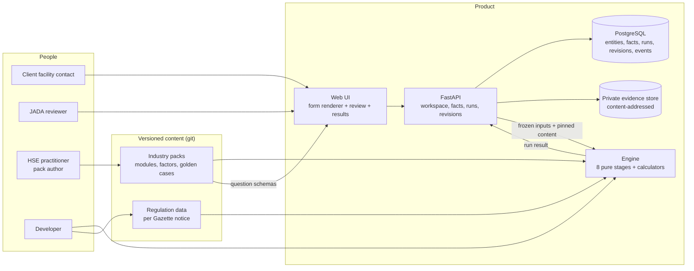
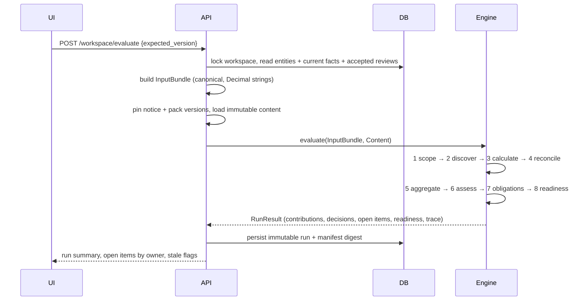

# 02 — Architecture overview

Prepared: 2026-11-09. Status: proposed. This document defines the layers, the design rules and the boundaries between them. The later documents specify each part in detail.

> **Revised 2026-11-11:** Rule 7 (signed golden cases gate every automatic branch) is replaced by [00 §8](00-automation-first-plan.md#8-accuracy-verification-without-per-branch-signatures); the intake layer is added in [00 §9.1](00-automation-first-plan.md#91-layers).

## 1. Context



Clients and JADA staff use one web application. Practitioners author packs in git: YAML, CSV and golden-case files, reviewed by pull request. Developers own the engine, calculators and regulation rule functions. The engine never touches the database or the network. It receives a frozen input bundle plus pinned content and returns a run result.

## 2. Layers

| Layer | Contents | Changes when | Owner | Size target (estimate) |
|---|---|---|---|---|
| **Platform** | Auth, tenants, facilities, reporting periods, SDS/purchase extraction and matching, evidence storage. This is existing JADA code. | Rarely | Developer | Existing |
| **Facts and lifecycle** | Entity rows, fact model, reviews, runs, revisions, events, digests, export. Mostly kept from v0. | Rarely | Developer | ~6–8k lines |
| **Engine** | Pipeline, eight stages, open-item model, aggregation, threshold helpers | Rarely; on notice structure changes | Developer | ~3–4k lines |
| **Calculators** | Registry of pure numeric methods (14 planned, 4 for welding) | When a pack needs a new kind of math | Developer, practitioner-checked | ~150–400 lines each |
| **Regulation data** | Substances, Part rules (named functions plus parameters), exemptions, stacks, filing fields, annual actions — per notice | Each Gazette notice, amendments | Developer and practitioner | Data plus ~1.5k lines of rule functions |
| **Industry packs** | Modules: questions, entity templates, method bindings, factor tables, output catalogues, coverage entries, golden cases | Every new process, factor or client finding | Practitioner and developer | Data only |
| **UI** | Form renderer, fact review, open-item queue, results and trace, package/lifecycle screens, 3–5 custom screens | When a new interaction type appears | Developer | ~12–15k lines |

The total application code target for 100% of the welding pack is about **25–30k lines**. v0 has about 65k new application lines for about 60%. These are estimates and are tracked as a budget in [13](13-delivery-cycles.md).

## 3. The seven design rules

Each rule states what is allowed, what is forbidden, and why.

### Rule 1 — Methods are calculators plus data rows

A **calculator** is a small, pure, versioned Python function that does one kind of math: activity × factor, composition, mass balance, fuel combustion and so on. A **module** in a pack binds its questions to a calculator and points at a factor table. A new electrode, fuel, coating or abrasive is a CSV row.

- *Forbidden:* a function named after one material or substance (`_build_arc_e310_outputs`), or `if method_id == ...` branches in the engine. Formula strings in data are never evaluated (`welding_candidate_factors.json` carries `formula: "factor_g_per_kg * electrode_kg / 1000"`). The formula becomes a calculator ID plus typed parameters.
- *Why:* 733 welding factor positions exist in the official workbook. Coverage must grow by import and review, not by engineering.

Specified in [05](05-calculators-and-factors.md).

### Rule 2 — Industries are versioned packs built from shared modules

A **pack** (`packs/metal_fab/pack.yaml`) lists the modules it uses. Some are shared (`welding_arc`, `surface_coating`, `degreasing`, `abrasive_blasting`, `boilers_heaters`) and some are its own. Each module and pack has a version such as `2026.1`. A run pins the exact pack version, so a filed report always knows which content produced it.

- *Forbidden:* industry-specific code paths in the engine. A pack containing code, expressions or arithmetic.
- *Why:* about 45 shared modules are used 252 times across 16 sectors in the scope estimate. Sharing is what keeps the total near 260k lines rather than 1.9M.

Specified in [06](06-pack-format-spec.md).

### Rule 3 — One fact model and one review flow

Every client answer, extracted value, JADA classification, inclusion decision, method choice, manual result and closure statement is a **fact**. A fact is keyed by a question ID declared in a pack or in core, validated by that question's schema, and carries evidence, author, provenance and version. Every human acceptance is a **review** on a fact version, bound to a dependency digest. The 15 v0 resolution kinds collapse into question IDs.

- *Forbidden:* a new table, resolution kind, API route or editor per regulatory feature.
- *Allowed:* a small fixed set of typed entity kinds (activity, material, allocation, flow, control, outlet, stream, incident, equipment), because these are industry-neutral and need referential integrity.

Specified in [03](03-domain-model-and-facts.md).

### Rule 4 — The engine is a list of small, pure stages

`evaluate(bundle) -> RunResult` is a fixed list of eight stages:

1. scope;
2. discover;
3. calculate;
4. reconcile;
5. aggregate;
6. assess;
7. obligations;
8. readiness.

Each stage takes an immutable typed state and returns a new one. No stage does I/O. No stage file exceeds about 400 lines.

- *Forbidden:* a cross-cutting evaluator function that knows every feature. Stage code that reads a pack module ID or a substance ID literally.

Specified in [04](04-engine-pipeline.md).

### Rule 5 — The UI is generated from the pack

Question types are a closed set:

- screen answer (Yes / No / Not sure / Done by someone else);
- choice and multi-choice;
- quantity with unit;
- quantity range;
- date and period;
- text;
- entity reference;
- repeating table;
- file evidence.

One renderer draws them from the pack. Results, open items and traces render from the run result. Custom screens are allowed only for interactions that genuinely differ: material reconciliation, the source-to-outlet map, the package/certification flow and perhaps two more.

- *Forbidden:* a hand-written editor for a single regulatory feature.

Specified in [09](09-review-workflow-and-generated-ui.md).

### Rule 6 — Regulation is data, one folder per Gazette notice

`regulation/notice_2025_2027/` holds substances, thresholds, Part definitions, exemptions, stack criteria, filing fields and annual actions. Rule *logic* is a small library of named, versioned Python functions. The notice folder supplies their *parameters* and source locators. The reporting year selects the notice. When the next notice arrives (expected for the 2028 reporting year), a new folder is added and the old one stays frozen for replay.

- *Forbidden:* hard-coded thresholds or Part membership in stage code.

Specified in [07](07-regulation-as-data.md).

### Rule 7 — Golden cases are the specification and the review unit

Each module ships with 2–5 sample facilities: inputs, expected quantities by substance and medium, expected open items, and expected Part decisions. An HSE practitioner writes or checks them and signs them, with name, date and pack version. The engine must match them exactly in Decimal. A module cannot be marked `automatic` without signed cases. Code review then concentrates on engine and calculator diffs. Practitioner review concentrates on data and expected answers.

- *Forbidden:* tests whose expected value comes from calling the production code. Unsigned cases presented as validation.

Specified in [10](10-golden-cases-and-verification.md).

## 4. How a run flows



The engine is deterministic. The same bundle and content digests give a byte-identical canonical result. That is what makes replay ([11](11-lifecycle-freshness-and-replay.md)) and golden cases ([10](10-golden-cases-and-verification.md)) possible.

## 5. Dependency boundaries

Allowed imports point downward only.

```text
api/            → services/, core/engine (call only), core/facts, core/lifecycle
services/       → core/*, db models
core/engine/    → core/types, core/calculators (via registry), core/rules (via registry)
core/calculators/ → core/types only
core/rules/     → core/types only
core/facts/     → core/types
core/lifecycle/ → core/types, core/facts
content/ (regulation, packs) → nothing (data only; validated by core/content loader)
frontend/       → API DTOs only; never computes regulatory results
```

A CI check (`import-linter` or a 30-line custom script) enforces these boundaries. It also checks that `core/engine/**` contains no string literal matching a pack module ID, a question ID pattern (`P\d\d-\d+`, `G\d\d`) or a substance ID. That one check prevents most of the drift v0 experienced.

## 6. Where each v0 concept lands

| v0 concept | New home |
|---|---|
| `WorkspaceInputs` typed collections | Entity rows (fixed kinds) plus facts ([03](03-domain-model-and-facts.md)) |
| 15 resolution `payload_type` kinds | Question IDs in core or pack, with one review flow |
| `Decision` envelope | Unchanged; produced by stages 1, 2, 6 and 7 |
| `Requirement` | `OpenItem` (same fields; owner client / jada / developer / practitioner) |
| `Contribution` | Unchanged contract; produced only by calculators and the `manual` path |
| Source inventory, source scope, expected outputs, slots | Stage 2 (inventory, candidate floor) and stage 4 (slot closure, quantity origins) |
| `ReconciliationSpec` union | Stage 4 reconcilers: named, few, parameterized by pack data |
| `aggregation.py`, `thresholds.py`, `facility_cases.py` | Stages 5–6, kept largely as is |
| `reporting_obligations.py`, `reporting_metadata.py`, `reporting_duties.py` | Stage 7, driven by `regulation/.../filing_fields.yaml` and `obligations.yaml` |
| `readiness.py` | Stage 8 |
| `catalogue_2026.json` | `packs/metal_fab/` modules and core common questions |
| `welding_candidate_factors.json`, `blasting_…`, `natural_gas_…` | Module `factors.csv` files |
| `substances_2026.json`, `reporting_obligations_2026.json`, `filing_fields_2026.json` | `regulation/notice_2025_2027/` |
| `release_coverage_2026.json` | Per-module `coverage` entries, compiled into one coverage register |
| Digests, snapshots, lifecycle projection, package export | `core/lifecycle/`, kept |

## 7. Technology choices

| Choice | Decision | Reason |
|---|---|---|
| Backend | FastAPI, SQLAlchemy, Alembic, PostgreSQL (unchanged) | Existing stack; no reason to change |
| Content format | YAML for modules and rules, CSV for factor tables, JSON for large generated registries | Practitioners can edit CSV in a spreadsheet; YAML allows comments; PR diffs stay readable |
| Content loading | `yaml.safe_load` → Pydantic v2 models → frozen dataclasses; JSON Schema exported for editor autocompletion | Strict validation at load; no code execution |
| Numbers | `decimal.Decimal` everywhere in accepted records and calculators; strings in JSON | Unchanged v0 rule |
| Units | A small unit table (mass, volume, time, energy, distance, fractions) with exact conversion factors in data; no general units library at runtime | Keeps conversions explicit and reviewable |
| Frontend | React + TanStack (unchanged), plus a form renderer driven by the catalogue DTO | Existing design system |
| Background work | Celery/Redis only for extraction and large exports; evaluation is synchronous and fast | Evaluation of one facility is milliseconds to seconds |

## 8. Non-goals

- **No rule expression language** and no user-authored formulas. The routing grammar in [06](06-pack-format-spec.md#5-routing-grammar) is a closed equality/inclusion language with no arithmetic.
- **No graph database and no general dependency-graph product.** Stage order is fixed, and stage 4 handles the few true cycles by construction ([04](04-engine-pipeline.md#3-ordering-and-the-threshold-before-emissions-problem)).
- **No runtime LLM in arithmetic,** factor selection or rule decisions. AI stays in extraction, classification suggestions and drafting explanations, as in the [roadmap](../README.md#small-software-building-blocks).
- **No client-editable packs** and no per-tenant pack forks in v1. A client-specific factor such as a site-specific emission factor is a reviewed fact, not a pack edit.
- **No full ECCC SWIM machine format** in v1. The package export remains the JADA preparation and retention package.
