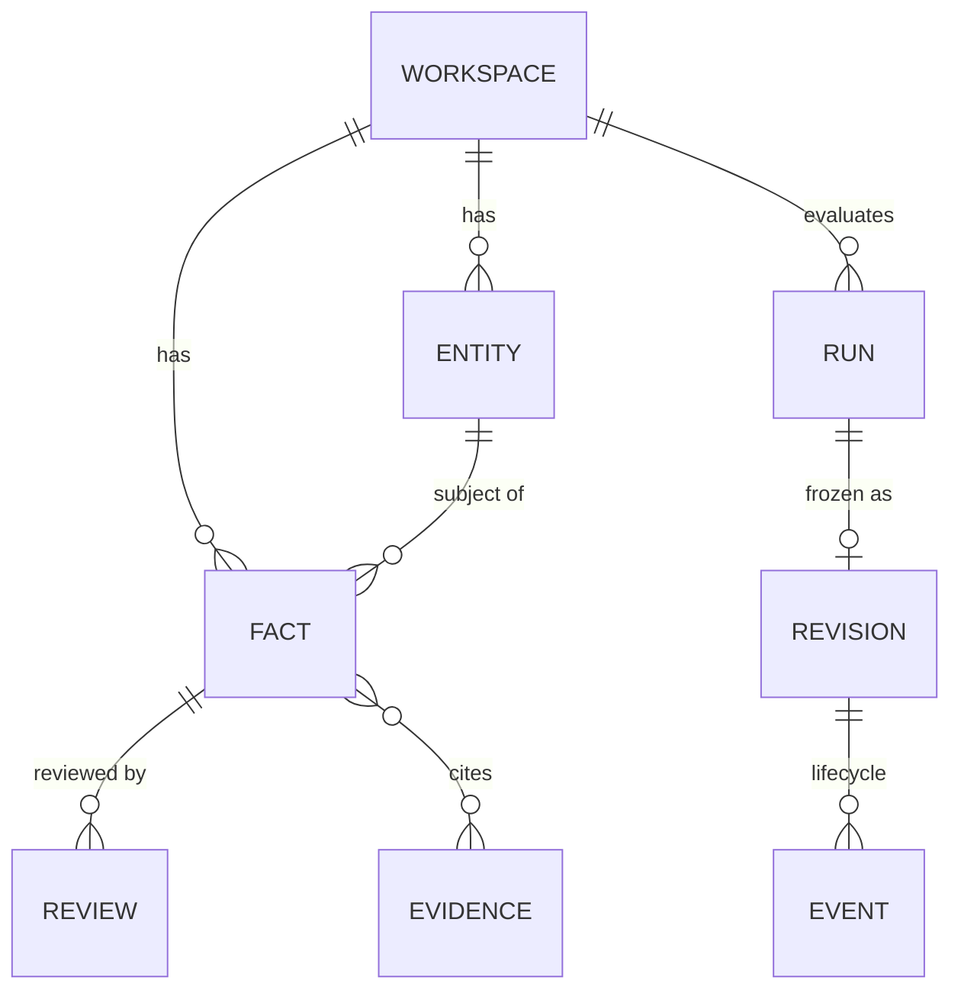

# 03 — Domain model and the one fact model

Prepared: 2026-11-09. Status: proposed contract. This replaces v0's `WorkspaceInputs` collections and the 15 resolution payload kinds with:

> **Revised 2026-11-11:** Fact fields and review policies are extended in [00 §5.5](00-automation-first-plan.md#55-candidate-facts) and [00 §9.3](00-automation-first-plan.md#93-changes-to-the-core-model); the §2.3 review-policy table is replaced.

- a small fixed set of entity kinds;
- one fact model;
- one review model.

It keeps every invariant in the [v0 implementation plan](../v0-implementation-plan.md#typed-inputs-v1) and the [closure design](../v0-closure-design.md).

## 1. The problem with v0's shape

v0 has two places where human knowledge lives:

1. **Typed input collections** in one JSONB document (`facility`, `employee_hours`, `screens`, `answers`, `activities`, `facts`, `materials`, `allocations`, `material_flows`, `controls`, `outlets`, `streams`, `incidents`). Clients and staff edit it with an expected version.
2. **Resolutions**: staff-authored records of 15 kinds (`fact`, `applicability`, `inclusion`, `method_assignment`, `manual_contribution`, `source_inventory`, `source_scope`, `output_closure`, `stack_decision`, `reporting_output`, `reporting_category_coverage`, `reporting_metadata`, `prior_report_acceptance`, `other_process_mapping`, `filing_workflow`). Each has its own payload schema, validator and review service, and usually its own editor.

Every new regulatory duty therefore needed a new kind, which is the vertical slice described in [01](01-why-change-v0-diagnosis.md#six-structural-causes). Yet each kind has the same structure: *a person states a value about a subject, with evidence and reasoning; it may need another person's acceptance; it becomes stale when what it depends on changes.*

## 2. Three building blocks



### 2.1 Entities: the things in a facility

Entities are the physical and organizational things that facts are about and that other entities reference. The kinds form a **closed, industry-neutral set**. A new industry does not add an entity kind. It adds facts on existing kinds.

| Kind | Meaning | Core attributes (typed columns or validated JSONB) | References |
|---|---|---|---|
| `facility_year` | The reporting case (one per `ReportingPeriod`) | year, notice ID, pack ID/version | — |
| `activity` | An operation performed in the year | module ID, subtype, label, period, `physical_operation_id` | equipment, controls, outlets, streams |
| `equipment` | A machine or unit (welder, booth, boiler, engine, tank, collector) | label, equipment class, capacity fact refs | activity |
| `material` | A purchased or produced material or product | label, inventory/SDS/purchase refs | — |
| `allocation` | A consumable or fuel split of a material to an activity | quantity, unit, kind (`consumable_split` or `fuel_split`) | material, activity |
| `material_flow` | Sequential lineage of a stock batch through operations | batch ID, from/to activity, quantity, loss stream | material, activities, stream |
| `control` | Capture or removal device or practice | type, pollutant scope | activities, outlets, residue streams |
| `outlet` | Where air leaves (stack, vent, fugitive, indoor recirculation) | route enum | activities, controls |
| `stream` | Waste, recycling, water or retained residue | kind, destination enum | activities |
| `incident` | Spill, leak, fire, upset | date | material, stream |

That is 10 kinds, the same as v0's collections. They become rows in one `entities` table with a `kind` column, a validated `attrs` JSONB and an `entity_refs` table for references. Referential integrity (same workspace, valid kind pairs) is enforced in the service layer and by a reference-check constraint.

Entity attributes are limited to identity and structure. Quantities, compositions, classifications, capture percentages and dates of change are **facts on the entity**. That way they get evidence, ranges, unknown states and review.

### 2.2 Facts: everything anyone states

```text
Fact
  id                uuid
  workspace_id      uuid
  question_id       str            # declared in core or a pack module, e.g. "P01-2", "G05.employee_hours",
                                   #   "jada.method_eligibility", "jada.inclusion"
  subject           {kind, id}     # facility_year | entity | contribution slot | output slot | run item
  instance_key      str?           # for repeating answers (row key in a table question)
  state             known | range | unknown | unavailable | not_applicable
  value             JSON           # validated by the question's value schema; Decimal as string
  unit              str?           # validated against the question's unit dimension
  period            {start, end}?  # ISO dates within the reporting year
  basis             str?           # purchased | used | estimated | measured | supplier | ...
  evidence_ids      uuid[]
  reasoning         str?           # required when the question says so (JADA decisions)
  source_refs       str[]          # S-IDs, notice locators, factor row IDs
  provenance        client | extracted | derived | jada | practitioner
  author_id, authored_at
  version           int            # per (question_id, subject, instance_key) chain
  supersedes        uuid?
  dependency_digest str            # digest of what the author saw (see §4)
```

A fact never changes. An edit creates a new version that supersedes the previous one. The **current fact** for a key `(question_id, subject, instance_key)` is the latest version that is not withdrawn.

### 2.3 Reviews: one acceptance mechanism

```text
Review
  id, fact_id, fact_version
  action            accept | reject | return_to_client
  reviewer_id, reviewed_at, reason
  dependency_digest str            # must equal the digest recomputed at review time
  independent       bool           # reviewer != author (enforced where the question requires it)
```

Whether a fact needs review, and what kind, is declared by its **question** rather than its table:

| Question `review` policy | Meaning | Example |
|---|---|---|
| `none` | Client statement used as is; still versioned and evidenced | Facility contact phone |
| `jada` | A JADA reviewer must accept before the engine treats it as accepted | Annual material use, a P01 electrode class |
| `independent` | Must be accepted by a reviewer other than the author | Manual calculation result, source inventory disposition, inclusion/exclusion |
| `practitioner` | Accepted by a named practitioner role | Interpretation hold resolution (I03, I04) |

The engine sees only **accepted** facts where the question requires review. A fact that is proposed but not accepted produces an open item for the reviewer, not a value.

## 3. Questions: the schema for facts

Questions are declared in two places:

- **Core questions** live in `core/questions/`. They are industry-neutral: facility identity, the G01–G17 common questions, employee hours, the material reconciliation questions M01–M08, controls and outlets O01–O08, and JADA decision questions.
- **Module questions** live in pack modules. P01-1 to P01-5 are an example ([06](06-pack-format-spec.md)).

Each question declares:

```yaml
id: P01-2
subject: activity            # which entity kind (or facility_year) it attaches to
ask: Electrode or wire used in 2026, by classification
help: Use the classification printed on the box (for example E7018, ER70S-6).
type: table
columns:
  class:  {type: choice, options_from: factor_keys.consumable_class, allow_other: true}
  mass:   {type: quantity, dimension: mass}
  basis:  {type: choice, options: [used, purchased_adjusted, estimated]}
states: [known, range, unknown, unavailable]    # allowed states
evidence: [packaging, sds, purchase_records, consumable_log]
owner: client
review: jada
visible_when: {screen: P01, answer: yes}
```

The **value schema** (type, columns, dimension, options, allowed states) is compiled into a Pydantic model at content-load time. The API validates every fact against it. The frontend renders from the same compiled schema delivered in the catalogue DTO.

### 3.1 How the 15 v0 resolution kinds map

| v0 `payload_type` | New question ID (core) | Subject | Review policy |
|---|---|---|---|
| `fact` | the question being accepted (e.g. `P01-2`) | entity | `jada` |
| `applicability` | `jada.applicability` | facility_year or entity, scoped by rule ID | `independent` |
| `inclusion` | `jada.inclusion` | contribution slot | `independent` |
| `method_assignment` | `jada.method_assignment` | activity | `jada` |
| `manual_contribution` | `jada.manual_result` | output slot(s) | `independent` |
| `source_inventory` | `jada.source_disposition` | each entity or imported candidate | `independent` |
| `source_scope` | `jada.source_scope` | activity / physical operation | `independent` |
| `output_closure` | `jada.output_closure` | output slot | `independent` |
| `stack_decision` | `jada.stack_assessment` | outlet | `practitioner` while I03/I04 are open |
| `reporting_output` | `jada.reporting_output` | reporting slot | `independent` |
| `reporting_category_coverage` | `jada.category_coverage` | substance × category | `independent` |
| `reporting_metadata` | filing-field questions `F.*` from `filing_fields.yaml` | facility_year | `jada` |
| `prior_report_acceptance` | `F.prior_report` | facility_year | `jada` |
| `other_process_mapping` | `G17.mapping` | facility_year → activities | `jada` |
| `filing_workflow` | `jada.annual_action` | facility_year, by action ID | `independent` |

The payload structures from v0 (for example `SourceScopeResolutionPayload` fields) become the **value schemas** of these questions. They are written once as core question definitions, not as separate Pydantic classes, services and routes.

### 3.2 Derived facts

Some values are computed from other facts by a named **derivation**, such as:

- `employee_hours_total` from G05 categories;
- `wind_class` from the annual mean wind speed, using the nearest-listed-class rule from the blasting source;
- `annual_use` from opening stock, receipts, returns, transfers and closing stock.

Derivations are pure Python functions in `core/derivations/`, referenced by ID and version from question definitions (`derive: annual_use_from_stock@1`). They produce facts with `provenance: derived` and a trace. If a derivation's inputs are unknown, its output is unknown. A JADA reviewer may override a derived fact only by authoring a `jada` fact that supersedes it, with reasoning.

## 4. Dependency digests and staleness

Every fact and review carries the `dependency_digest` of the inputs the author relied on. The question declares which inputs:

```yaml
id: jada.manual_result
depends_on:
  - subject_facts          # all current facts on the subject entity
  - linked_entities        # entities referenced by the subject, and their current facts
  - pinned_content: [notice, pack_module, method]
  - accepted_reviews_of: [jada.source_scope, jada.method_assignment]
```

At evaluate, review, revision, approval, certification and filing, the server recomputes each accepted fact's digest. If it differs, the review is **stale**: the engine treats the fact as unaccepted and raises an open item for the reviewer. This keeps v0's freshness contract ([closure design §7](../v0-closure-design.md#7-freshness-and-authoritative-readiness)). Instead of a hook per feature, there is one generic recomputation over declared dependency kinds.

Cycles are rejected at content-load time: a question may not depend, directly or transitively, on reviews of itself.

## 5. Engine-side records

These are produced by the engine and stored inside the immutable run result. They are not edited by people.

| Record | Fields (summary) | Produced by |
|---|---|---|
| `Decision` | `decision_id, subject, rule_id@version, state (resolved / needs_input / needs_interpretation / unsupported), value?, input_refs, source_refs, reasons` | Stages 1, 2, 6, 7 |
| `OpenItem` | `id (stable), key, owner (client / jada / practitioner / developer), kind, subject, question_id?, reason, evidence_options, blocking, dependent_ids` | All stages |
| `Contribution` | `id, slot_id, quantity_origin_key, aggregation_key, source_entity_ids, substance_id, chemical_basis, quantity_kind (material / assessment / release / disposal / recycling / internal_balance), quantity or [lo, hi], unit, medium/category, method {calculator@v, module@v}, factor_row_ids, input_fact_ids, rating, flags, trace_steps` | Stage 3 (calculators and manual), adjusted in stage 4 |
| `OutputSlot` | `slot_id (derived), owner source, substance, basis, role (threshold_quantity / reporting_output / internal_balance), route, period, state (quantified / evidenced_zero / not_applicable / permitted_no_information / pending)` | Stage 2 (derive), stage 4 (close) |
| `Assessment` | `subject (substance/group × Part), basis, comparator, boundary, contributing/excluded/pending IDs, outcome (met / not_met / pending / not_applicable), reasons` | Stage 6 |
| `Obligation` | `id, part, substance, category/field, required, satisfied_by, state` | Stage 7 |
| `Readiness` | `can_request_review, can_approve, blockers[]` | Stage 8 |

`Contribution` keeps v0's contract field by field. An automatic and a manual contribution are indistinguishable except for `method.calculator`, which is `manual@1` for reviewed manual results ([05](05-calculators-and-factors.md#5-the-manual-calculator)).

`OpenItem` IDs are stable: `hash(workspace, year, owner, kind, subject, key)`. Identical runs produce identical open items, so the queue doesn't churn.

## 6. Persistence

| Table | Purpose | Notes |
|---|---|---|
| `workspaces` | One per reporting period; `version`, pinned `notice_id`, `pack_id`, `pack_version` | Row lock plus expected-version on mutation (unchanged) |
| `entities` | All entity kinds | `kind`, `attrs` JSONB validated per kind, `created_version`, `retired_version` |
| `entity_refs` | Typed references between entities | Checked kind pairs |
| `facts` | All facts, append-only versions | Unique `(workspace, question_id, subject, instance_key, version)` |
| `fact_evidence` | Fact ↔ evidence | |
| `reviews` | All reviews | Append-only |
| `evidence` | Private, content-addressed evidence | Kept from v0 `workspace_evidence` |
| `runs` | Immutable evaluation results | Kept from v0 `workspace_runs`; adds pinned content digests |
| `revisions` | Frozen packages | Kept from v0 |
| `events` | Lifecycle events | Kept from v0 |

That is about 10 tables for the workspace domain, compared with v0's 25. Migration from v0's JSONB collections and resolutions is a one-time transform ([12](12-migration-from-v0.md#4-data-migration)).

### Why not pure entity–attribute–value?

A fully generic EAV model would also make entities and references untyped. That loses referential checks such as "an allocation must reference a material and an activity in this workspace" and makes queries painful. The split is deliberate:

- **structure** (what exists and what is connected) is typed and fixed;
- **knowledge** (what is true about it) is generic facts validated by pack schemas.

## 7. Invariants (carried from v0, enforced generically)

1. Decimal strings only in accepted values; no binary floats. Non-finite, negative-where-forbidden or reversed ranges are rejected at fact validation.
2. Unknown is a state, never a zero. Numeric zero is valid only with a basis (`evidenced_zero`).
3. Concentrations are stored as Decimal with an explicit `percent` or `mass_fraction` basis. They are normalized exactly once, at the calculator boundary.
4. Purchases are not use. Annual use is a fact, either answered or derived, with its own evidence.
5. Allocation totals cannot exceed accepted annual use. The unallocated balance is shown and reconciled in stage 4.
6. A client cannot author `jada.*` or `F.*` facts, or any review. This is checked from question `owner` and actor role, not per endpoint.
7. Absence of an activity is a fact with an actor and a time, for this facility and year only.
8. Cross-tenant references are impossible. Every entity, fact, evidence and review reference is checked against the workspace's owner.
