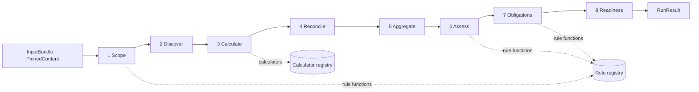

# 04 — Engine pipeline

Prepared: 2026-11-09. Status: proposed contract. This document replaces v0's `evaluate_frozen_inputs` (`evaluator.py:5141`, 804 lines, about 40 helpers) with a fixed list of eight pure stages. The regulatory behavior is unchanged from the [regulatory inventory](../v0-regulatory-inventory.md) and the [closure design](../v0-closure-design.md). This is a restructuring, not a reinterpretation.

> **Revised 2026-11-11:** Quantities become intervals and outcomes get a robustness test and sensitivity pass ([00 §7](00-automation-first-plan.md#7-materiality-the-robustness-test-and-the-exception-queue)). The stages are unchanged.

## 1. Shape

```python
# core/engine/pipeline.py  (~40 lines)
STAGES = (scope, discover, calculate, reconcile, aggregate, assess, obligations, readiness)

def evaluate(bundle: InputBundle, content: PinnedContent) -> RunResult:
    state = S0.from_bundle(bundle, content)
    for stage in STAGES:
        state = stage.run(state, content)        # pure; returns a new frozen state
    return RunResult.from_state(state, engine_version=ENGINE_VERSION)
```

- **`InputBundle`** is the canonical frozen workspace: entities, current facts, accepted reviews, evidence digests and linked upstream records (purchases, SDS, inventory). The API service builds it ([11](11-lifecycle-freshness-and-replay.md)).
- **`PinnedContent`** is the immutable, digest-identified notice and pack content for this run: rules parameters, substances, modules, factor tables and calculator versions.
- **Each stage's state is its own frozen dataclass**, `S1` to `S8`. Each adds fields and cannot see fields that later stages produce. That makes "used before computed" a type error, not a runtime surprise.
- **No stage does I/O**, reads the clock, generates random IDs or imports API or DB modules. IDs are derived from content hashes. The CI boundary check in [02 §5](02-architecture-overview.md#5-dependency-boundaries) enforces this.



## 2. The stages

Each stage below lists its responsibility, inputs, outputs, the open items it can raise, the v0 code it is ported from, and a size target. Size targets are estimates.

### Stage 1 — Scope

**Responsibility:** decide which regulatory branches can apply to this facility-year before looking at processes.

- Select the notice from the reporting year. 2026 selects `notice_2025_2027`.
- Classify the facility category (contiguous, portable, pipeline installation or offshore) from accepted facts.
- Compute employee hours from G05 categories via a derivation. Apply the 20,000-hour gate **per Part**, never as one boolean.
- Record present / absent / unknown for each Schedule 3 §1(1)(a) employee-threshold-exempt activity, and for the §1(2) only-activity exclusions.
- Select the Part 4/5 facility case (§§11–13, §16), such as low-hours combustion-only scope.
- Record annual coverage, ownership dates and prior-reporter status (needed in stage 7).

**Outputs:** `Decision`s per Part (`part1A`…`part5`) with state and rule references; a `FacilityCase` value used by later stages.

**Open items:** unknown facility category, unresolved hours categories, unknown exceptional activity (`jada`), and ambiguous boundary or contractor hours (`client` plus `jada`).

**Ported from:** `facility_cases.py` (310), `rules.py` (216), `_part123_eligibility`, `_part45_facts`. **Target:** ~250 lines plus rule functions.

### Stage 2 — Discover

**Responsibility:** build the complete source inventory and the minimum set of outputs that must be accounted for. This stage makes sure omission can't look like absence.

- Read all process screens. The pack lists them; metal_fab has P01–P28 plus G17. A missing screen answer is an open item. A `yes` opens the module and requires at least one `activity` entity for it. `unknown` raises a classification open item. `other_party` requires a P28 boundary decision.
- Check that every entity and imported candidate (purchase lines, SDS, inventory rows) has an accepted `jada.source_disposition`: `in_scope`, `linked_to_source`, `outside_boundary`, `unused_in_year`, `duplicate_alias` or `unresolved`. This is v0's minimum inventory rule.
- Build **physical sources**: activities that share a `physical_operation_id` collapse to one source with several module labels.
- Build the **candidate floor** per source, as the union of:
  - accepted composition identities on linked materials and streams;
  - the declared output catalogue of each bound method (from the module);
  - the module's screening domains (Part 2 PAH, Part 3 activity, PFAS, VOC, combustion species, substrate/media metals);
  - incident materials.
  Unknown composition domains stay as unresolved candidates.
- Derive **output slots** deterministically from (source, period, substance/basis, role, route/stream/outlet). The first pass covers threshold and balance slots. Reporting-output slots are added in stage 7 once assessments are known.

**Outputs:** `SourceInventory`, `Source[]`, `CandidateFloor`, `OutputSlot[]` (pass 1), module activation decisions.

**Open items:** unanswered screen, positive screen without an activity, unassigned entity, unknown composition domain, G17 positive without mapping, P28 responsibility unknown.

**Ported from:** `coverage.py` (480), `_derive_source_closure` (`evaluator.py:2878`, ~450 lines), `derive_source_scope_preview`, `_family_applicability_issues`. **Target:** ~350 lines. This is the largest stage because of the inventory rules.

### Stage 3 — Calculate

**Responsibility:** turn accepted facts into contributions using calculators. This is the only stage that produces quantities.

For each in-scope source and each method binding of its module (see [06](06-pack-format-spec.md#3-moduleyaml)):

1. Check method eligibility. The binding's `requires` are accepted facts or derivations, and its `eligible_when` uses the routing grammar. If not eligible, record why. If the module's `fallback` is `manual`, expect a `jada.manual_result`.
2. Resolve the activity quantity from facts (for example `P01-2.mass` per row), applying allocation shares from stage 2.
3. Select factor rows by the binding's `match` keys. The outcome is one of `applicable`, `needs_input`, `no_supported_factor` or `incompatible` ([05 §3](05-calculators-and-factors.md#3-factor-selection)). Only `applicable` supplies a number.
4. Call the calculator with typed inputs and get contributions with full traces.
5. Add **material assessment** contributions (Part 1 MPO) from accepted composition using the `composition` calculator, keyed by lineage root, not by operation.
6. Add **manual** contributions from accepted `jada.manual_result` facts through the `manual` calculator, using the same contract.

Calculators are called through the registry by `id@version`. The stage never names a calculator, module or substance in code.

**Outputs:** `Contribution[]` (gross, before controls), `MethodDecision[]`.

**Open items:** missing activity quantity (`client`), missing factor (`jada`; becomes a method task, never a client question about factors), ineligible method without manual fallback (`developer`), composition needed (`client`), and manual result expected (`jada`).

**Ported from:** `methods.py` (324), `process_methods.py` (854), `organic_methods.py` (980), `combustion_adapter.py` (627), `composition.py`, `_build_arc_e310_outputs`, `_build_abrasive_blasting_outputs`, `_build_part1_material_assessments`, `_build_batch_material_contributions`, `_build_manual_contributions`. The method-specific bodies become calculators plus factor rows. **Target:** ~250 lines in the stage, with the math in calculators.

### Stage 4 — Reconcile

**Responsibility:** make the quantities physically consistent and count each physical amount once.

- **Allocations:** consumable and fuel splits sum to accepted annual use. Any remainder is reported, never silently spread.
- **Lineage:** sequential stock flows give one canonical origin for the stock quantity. Cutting, grinding and welding the same batch don't create three MPO quantities.
- **Quantity origins:** derive `quantity_origin_key` server-side from lineage, partition, period and role. Two contributions with the same origin in the same assessment and category is a blocking collision, not a sum.
- **Controls:** apply capture × removal per pollutant scope and operating segment. Route the captured share to the control's residue stream as `internal_balance` plus a stream output. Never credit a particulate filter against VOC, and never apply control to a factor that the factor row marks `controlled`.
- **Destinations:** assign each release, disposal or recycling contribution to a route: outlet, stream or water route. Shared streams own their final output once, and upstream generation stays as internal balance.
- **Slot closure:** bind each contribution to exactly one output slot. Close each slot as `quantified`, `evidenced_zero`, `not_applicable`, `permitted_no_information` or `pending`. Automatic and manual results on the same slot block until one is explicitly superseded.
- **Reconciliation specs:** run the module-declared reconcilers (material split, sequential loss, control routing, waste generation/storage/shipping, water recirculation/purge/sludge, outlet air total) with method-specific tolerance. Unexplained residuals block. There is no global tolerance.

**Outputs:** `Contribution[]` (net, routed), `OutputSlot[]` (closed states), `ReconciliationResult[]`.

**Ported from:** `balances.py` (192), `reconciliation.py` (732), `material_lineage.py`, `_bind_contributions_to_slots` (`evaluator.py:4233`), `_evaluate_scope_reconciliations`. **Target:** ~350 lines plus about 6 reconcilers of ~60 lines each.

### Stage 5 — Aggregate

**Responsibility:** total by the keys each rule needs.

- Group contributions by `aggregation_key`: facility × substance or group × Part × basis × quantity kind × medium/category.
- Apply group membership from the notice: an explicit group aggregates its members, while Part 1C PFAS stay individual.
- Apply Part-specific **source sets**: §13/§16 combustion-only threshold basis, §12 road dust inclusion, §2(3) fuel combustion included despite other exclusions. These come from rule functions selected in stage 1.
- Keep nested fractions nested. TPM, PM10 and PM2.5 are separate assessments, never summed together. Total VOC and individual VOCs are separate views of the same physical amount.
- Carry the contributing, excluded and pending origins into each aggregate. `contribution_set_complete` is derived from slot states, never hard-coded.

**Ported from:** `aggregation.py` (216), `_aggregate_current_threshold_candidates` (`evaluator.py:4712`). **Target:** ~200 lines.

### Stage 6 — Assess

**Responsibility:** apply each Part's criteria to the aggregates. The criteria are rule functions parameterized by notice data ([07](07-regulation-as-data.md)).

- Part 1A/1B/1C MPO thresholds with concentration gating and qualifiers, ranges and inclusive comparators on unrounded Decimal.
- Part 2 aggregate PAH trigger and the creosote branch.
- Part 3 activity-triggered branch, with no mass trigger.
- Part 4 CAC air thresholds and the external-combustion exemption (§14).
- Part 5 per-identity air thresholds and exemption (§17).
- Individual stack criteria per outlet, with interpretation holds (I03, I04) producing `needs_interpretation`.
- Outcome rules from v0: an interval entirely below the threshold gives `not_met` only when the set is complete. A lower bound at or above an inclusive threshold gives `met` even with pending contributions. Any other partial result is `pending`.

**Outputs:** `Assessment[]`, stack decisions.

**Ported from:** `thresholds.py` (479), `_derive_threshold_completeness`, `_evaluate_part3_activity_scope`, `stack_reporting.py` (257). **Target:** ~250 lines plus rule functions.

### Stage 7 — Obligations

**Responsibility:** derive what must be reported and filed, and check that it is present.

- For each `met` assessment, derive reporting-output slots (pass 2) per Schedule 4 category from `obligations.yaml`. Examples: Part 1 releases to air by detail code, disposals, transfers for recycling; Part 4 monthly distribution; condensable PM status; stack fields. This includes required zeros.
- Validate filing fields from `filing_fields.yaml`: each field has applicability and validator **IDs** that point at named Python functions, never predicate strings. Results are `valid`, `invalid`, `unknown` or `not_applicable`.
- Build the **annual action plan** from the assessments, prior-reporter status and ownership facts: substance report, DNMC, sale/closure/purchase, voluntary report, no-filing determination. Compatible actions coexist and obligatory ones cannot be removed.

**Outputs:** `Obligation[]`, `FilingFieldResult[]`, `AnnualActionPlan`.

**Ported from:** `reporting_obligations.py` (1,031), `reporting_duties.py` (306), `reporting_metadata.py` (961), `part1_reporting_completion.py` (458), `part4_*` modules, `annual_actions.py`, `workspace/filing_fields.py` (513). Most of their size is per-duty special-casing that becomes rows in `obligations.yaml`. **Target:** ~300 lines plus validator functions.

### Stage 8 — Readiness

**Responsibility:** decide what can happen next, and say exactly why not.

- Collect open items by owner. Stable IDs, deduplicated by key.
- `can_request_review`: no blocking `client` items.
- `can_approve`: complete discovery, all slots closed, reconciliations passed, all Part assessments resolved, obligations satisfied, filing fields valid, action plan ready, no blocking items of any owner, and every accepted fact fresh.
- Record the engine contract version and the coverage state of every activated module branch (`automatic`, `manual_supported`, `unsupported`). An `unsupported` branch that is reached always blocks.
- Pure evaluation never authorizes filing. Lifecycle gates in the service add approval, certification and actor checks ([11](11-lifecycle-freshness-and-replay.md)).

**Ported from:** `readiness.py` (579), `method_obligation_closure.py`, `_close_*_coverage`. **Target:** ~200 lines.

### Size summary

| Stage | Target lines (estimate) | v0 lines it replaces (approximate) |
|---|---|---|
| 1 Scope | 250 | ~700 |
| 2 Discover | 350 | ~1,400 |
| 3 Calculate | 250 (+ calculators) | ~4,500 |
| 4 Reconcile | 350 (+ reconcilers) | ~1,800 |
| 5 Aggregate | 200 | ~600 |
| 6 Assess | 250 | ~1,100 |
| 7 Obligations | 300 (+ validators) | ~4,500 |
| 8 Readiness | 200 | ~1,200 |
| Pipeline, state types, open items | 400 | (inside `evaluator.py`) |
| **Total engine** | **~2.5k + ~1.5k rules/validators** | **~18.5k** (`npri_v0/`) |

## 3. Ordering and the "threshold before emissions" problem

The [roadmap](../README.md#what-the-runtime-should-do-for-each-client) warns that some assessments depend on estimated releases, so a strict threshold-first order is wrong. The fixed stage order handles every dependency without iteration:

| Dependency | Why it is satisfied |
|---|---|
| Part 4/5 thresholds need air releases | Releases are computed in 3, controlled in 4, aggregated in 5 and assessed in 6 |
| Part 1 thresholds count by-products released or disposed, at any concentration | By-product contributions are computed in 3 with `assessment_basis: by_product` and aggregated in 5 |
| Reporting outputs are needed only once a threshold is met | Calculators compute **eagerly** whatever they can. Stage 7 decides which outputs are *required*. A missing input for a reporting-only output is non-blocking until stage 7 marks the substance reportable. |
| Low-hours Part 4/5 case changes which sources count | Stage 1 decides the case, and stage 5 applies the source set |
| Controls change releases that feed thresholds | Stage 4 runs before 5 and 6 |
| The annual action depends on all Parts | Stage 7 runs after 6 |

Eager computation is cheap: one facility has tens to hundreds of contributions. It removes the need for a dependency graph and for a two-pass evaluator that re-enters earlier stages.

A pending threshold leaves its downstream reporting slots `pending` with reason `awaiting_assessment`. They are shown but are not yet client tasks, so clients aren't asked for data that may turn out to be unnecessary.

## 4. Open items: one model for "what's missing"

Every stage reports gaps as `OpenItem`s. Owners and typical kinds:

| Owner | Typical kinds | UI destination |
|---|---|---|
| `client` | `missing_fact`, `missing_evidence`, `screen_unanswered`, `classify_unknown_activity` | Client "Questions for you" |
| `jada` | `review_fact`, `accept_disposition`, `select_method`, `manual_result_needed`, `resolve_collision`, `reconcile_residual` | JADA queue |
| `practitioner` | `interpretation_hold` (I03, I04 and future), `sign_golden_case` | Practitioner queue |
| `developer` | `unsupported_branch`, `calculator_missing`, `content_invalid`, `engine_error` | Engineering backlog |

A developer-owned item is never phrased as a question to the client. That was already a v0 rule. It is now structural, because only stage 3 can raise `calculator_missing` and it always assigns it to `developer`.

## 5. Errors

- **Invalid content** (bad YAML, unknown calculator, unit mismatch, missing source on a factor row) fails at **content-load time**, in CI and at service start, never during a client run.
- **A calculator exception** at runtime is caught by stage 3. It becomes a blocking `engine_error` open item with the calculator ID, version and a fingerprint, and the run is persisted as blocked. The run never shows a partial green state.
- **Invariant violations** (negative quantity from a calculator, slot double-bound, missing trace) raise in tests and become `engine_error` in production.

## 6. Determinism rules

1. All collections are sorted by stable keys before iteration and before output.
2. IDs are `sha256` digests of canonical content, never `uuid4()` inside the engine.
3. Decimal context is fixed (precision 34, `ROUND_HALF_EVEN` for internal arithmetic). Display rounding happens only in export, per the reporting unit's rule.
4. No `datetime.now()`. The run timestamp is set by the service outside the engine.
5. The canonical JSON of `RunResult` (sorted keys, Decimal strings) is digested and stored with the run.

## 7. Testing the engine

| Layer | What is tested | Expected values come from |
|---|---|---|
| Stage unit tests | Each stage with a hand-built frozen state | Hand-written expectations per stage contract |
| Calculator tests | Each calculator with dimensional and edge cases | Hand-worked arithmetic, official examples ([05](05-calculators-and-factors.md#7-calculator-acceptance)) |
| Rule function tests | Boundary fixtures from the [regulatory inventory](../v0-regulatory-inventory.md#synthetic-boundary-and-regression-fixture-specifications) | Notice text, reviewed by a practitioner |
| Golden cases | Whole-facility runs | Practitioner-signed expected results ([10](10-golden-cases-and-verification.md)) |
| Parity harness | New engine vs v0 on v0's supported cases during migration | v0 outputs as an oracle, with differences triaged ([12](12-migration-from-v0.md#3-parity-harness)) |
| Property tests | Determinism; no unknown→zero; adding an unrelated entity never changes an unrelated assessment; removing a candidate never turns a pending result into `not_met` | Invariants |
