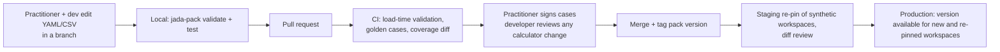

# 06 — Pack format specification

Prepared: 2026-11-09. Status: proposed format, version `pack-format/1`. This document defines exactly what a pack may contain, how it is validated, and what it may never contain. Examples use real v0 content: question IDs from `catalogue_2026.json` and the E310 factor row from `welding_candidate_factors.json`. They show the format, not finished pack content.

> **Revised 2026-11-11:** Additions (`defaults.yaml`, `policy.yaml`, taxonomy, `prefill`, band questions) are in [00 §9.4–9.5](00-automation-first-plan.md#94-additions-to-the-pack-format). The "≥ 2 signed cases per automatic branch" release check is replaced by parity plus pack scenario cases.

## 1. Layout

```text
content/
  regulation/
    notice_2025_2027/            # see 07
  packs/
    shared/                      # modules reusable by any pack
      welding_arc/
        module.yaml
        factors.csv
        cases/
          c01-small-shop-e310.yaml
          c02-unknown-electrode.yaml
      thermal_cutting/
      thermal_spray/
      abrasive_blasting/
      degreasing/
      surface_coating/
      powder_coating/
      boilers_heaters/
      stationary_engines/
      storage_tanks/
      waste_streams/
      water_routes/
      road_dust/
      ...
    metal_fab/                   # the welding and fabrication pack
      pack.yaml
      modules/                   # pack-specific modules (only if not shared)
        other_joining/
        specialist_surface/
      cases/                     # whole-facility golden cases
        f01-mixed-shop.yaml
      import/                    # source workbooks' import manifests and scripts output
        eccc-welding-2022-10-26.manifest.yaml
```

Shared modules live under `packs/shared/` from the start, even while only one pack uses them. Moving them later would change module IDs inside filed history.

## 2. `pack.yaml`

```yaml
format: pack-format/1
id: metal_fab
version: 2026.1                       # YEAR.N; N increments on any released content change
label: Welding and metal fabrication
notice: notice_2025_2027              # the regulation folder this pack targets
reporting_years: [2026]
naics_hint: ["3323", "3329", "3327", "3364", "3332", "3339"]   # discovery help only; never a rule
modules:                              # order = order shown in the activity screen
  - {use: shared/welding_arc@2026.1,        screen: P01}
  - {use: shared/welding_tig_plasma@2026.1, screen: P02}
  - {use: metal_fab/other_joining@2026.1,   screen: P03}
  # ... P04–P28, one entry per screen (see 08)
common_questions: core/common@2026.1  # G01–G17, M01–M08, O01–O08
catch_all: G17                        # mandatory "anything else?" question
whole_facility_cases: cases/
exceptional_activity_screen: core/schedule3_s1_1a@2025-2027   # internal JADA reconciliation
release_states:                       # what this pack version claims, per module (see §7)
  generated_from: modules[*].coverage
```

## 3. `module.yaml`

A module is one process family, or a family plus its variants. It declares everything the engine and UI need about that family.

```yaml
format: module-format/1
id: welding_arc
version: 2026.1
label: Stick, MIG/flux-core or submerged-arc welding using rods or wire
help: Includes robotic welding and hardfacing done with these processes.
sources: [S04, S05, S06]

screen:                                 # the activity-screen entry
  id: P01
  prompt: Stick, MIG/flux-core or submerged-arc welding using rods or wire
  answers: [yes, no, unknown, other_party]

entity:                                 # what a "yes" creates
  kind: activity
  min_instances: 1
  label_hint: "e.g. Bay 2 stick welding"

questions:
  - id: P01-1
    subject: activity
    ask: Which welding processes were used?
    type: multi_choice
    options: [SMAW, GMAW, FCAW, SAW]
    states: [known, unknown]
    owner: client
    review: jada
  - id: P01-2
    subject: activity
    ask: Electrode or wire used in 2026, by classification
    type: table
    columns:
      process: {type: choice, options_from: P01-1}
      class:   {type: choice, options_from: factors.consumable_class, allow_other: true}
      mass:    {type: quantity, dimension: mass}
      basis:   {type: choice, options: [used, purchased_adjusted, estimated]}
    states: [known, range, unknown, unavailable]
    evidence: [packaging, sds, purchase_records, consumable_log]
    owner: client
    review: jada
  - id: P01-3
    subject: activity
    ask: What base metals and coatings were welded?
    type: table
    columns:
      material: {type: entity_ref, kind: material}
      coating:  {type: text}
    owner: client
    review: jada
  # P01-4, P01-5 ...
shared_questions: [M01, M02, M03, M04, M05, M06, M07, M08, O01, O02, O03, O04, O05, O06, O07, O08, P23-1, P24-1]

methods:                                # bindings; order = preference
  - id: arc-listed-v1                   # v0 method ID preserved as binding ID
    calculator: activity_x_factor@1
    factors: factors.csv
    filter: {method_variant: listed}
    for_each: P01-2                     # one calculation per table row
    activity: P01-2.mass
    match: {process: P01-2.process, consumable_class: P01-2.class}
    outputs_from: factors               # every substance row for the matched key
    on_no_factor: next_method
  - id: arc-other-method1-v1
    calculator: activity_x_factor@1
    factors: factors.csv
    filter: {method_variant: other_method1}
    for_each: P01-2
    activity: P01-2.mass
    match: {process: P01-2.process}
    eligible_when: {fact: jada.method_eligibility, equals: other_method1_justified}
    on_no_factor: manual
  - id: arc-pm25-from-pm10-v1
    calculator: composition@1
    mode: speciate_output
    parent: {output_of: [arc-listed-v1, arc-other-method1-v1], substance: "part4:NA - M09"}   # PM10 → PM2.5 (part4:NA - M10)
    factors: factors.csv
    filter: {method_variant: pm_fraction}
fallback: manual                        # if no binding applies

outputs:                                # the candidate floor this module guarantees
  declared_by_methods: true
  screening_domains:
    - {domain: substrate_metals, from: P01-3.material}
    - {domain: coating_decomposition, from: P01-3.coating, owner: jada}
    - {domain: part2_pah, state: evidenced_absent_by_default, rule: not_a_part2_source, review: jada}

controls: shared                        # uses core control/outlet questions O01–O08
reconcilers:
  - consumable_split: {material_question: P01-2, allocation_kind: consumable_split}

coverage:                               # honest declaration per branch
  - {branch: SMAW listed electrode,  state: automatic,        when: factor applicable}
  - {branch: GMAW/FCAW/SAW listed,   state: automatic,        when: factor applicable}
  - {branch: Other electrode (Method 1), state: automatic,    requires: jada.method_eligibility}
  - {branch: Composition (Method 2), state: manual_supported, note: "binding planned; see 08 §4"}
  - {branch: Hardfacing,             state: manual_supported}

cases: cases/                           # ≥2 signed cases required for any automatic branch
```

### Keys reference

| Key | Required | Meaning |
|---|---|---|
| `format`, `id`, `version`, `label`, `sources` | yes | Identity and provenance. `sources` must exist in the source register. |
| `screen` | yes for screened modules | The activity-screen entry; IDs come from the questionnaire |
| `entity` | yes | What a positive screen creates, and the minimum instance count |
| `questions` | yes | Question definitions ([03 §3](03-domain-model-and-facts.md#3-questions-the-schema-for-facts)) |
| `shared_questions` | optional | References to core questions that this module activates |
| `methods` | optional | Calculator bindings, tried in order. A module with no methods is manual-only. |
| `fallback` | yes | `manual` or `blocking`. `manual` means an expected `jada.manual_result`; `blocking` means the developer must implement it. |
| `outputs` | yes | Candidate floor: method-declared outputs plus screening domains |
| `reconcilers` | optional | Named reconcilers with parameters (stage 4) |
| `coverage` | yes | Branch states; compiled into the coverage register |
| `cases` | yes for any `automatic` branch | Golden case folder |
| `derivations` | optional | Named derivation functions used by this module's questions |

## 4. Binding fields

| Field | Meaning |
|---|---|
| `calculator` | `id@version` from the registry |
| `factors` + `filter` | Which table, and which subset of rows (by `method_variant` or another key) |
| `for_each` | Iterate over rows of a table question, or over linked entities (`entities: material`) |
| `activity` | Path to the activity quantity fact; dimensions are checked against the calculator |
| `match` | Factor key column → fact path |
| `inputs` | Extra calculator inputs → fact paths or constants with units (`{fraction_of_activity: P09-3.fraction}`) |
| `eligible_when` | Routing-grammar condition on accepted facts |
| `requires` | Facts that must be accepted, otherwise a `needs_input` open item is raised |
| `on_no_factor` | `next_method`, `manual` or `blocking` |
| `parent` | For `speciate_output`: which binding's output, and which substance, is the parent |
| `prefer` | `site_factor`: use an accepted `jada.site_factor` when present |

## 5. Routing grammar

Visibility (`visible_when`) and eligibility (`eligible_when`) use a tiny closed grammar. It has no arithmetic, no variables, no functions, no loops and no string building.

```text
cond := {screen: ID, answer: VALUE}
      | {fact: QUESTION_PATH, equals: VALUE}
      | {fact: QUESTION_PATH, in: [VALUE, ...]}
      | {fact: QUESTION_PATH, state: STATE}
      | {has_entity: KIND}
      | {all: [cond, ...]} | {any: [cond, ...]} | {not: cond}
```

The interpreter is under 80 lines and is exhaustively tested. Anything that needs comparison of numbers, unit math or date logic must be a **named derivation** (code, reviewed) that produces a fact. The grammar can then test that fact by equality. This is the line that stops YAML turning into a programming language ([15](15-decisions-risks-open-questions.md), ADR-004).

## 6. What a pack may never contain

| Forbidden | Why | Enforced by |
|---|---|---|
| Arithmetic or formula strings that get evaluated | Untestable, unreviewable logic in data | Loader rejects unknown keys; `formula`/`notes` are inert text |
| Python, JS or templating of any kind | Same | `yaml.safe_load`; no custom tags; no `!!python` |
| Regulatory thresholds, Part membership or exemption parameters | These belong to the notice, not the industry | Schema has no such keys |
| A substance ID that is not in the pinned notice (except `unresolved:*`) | Identity must come from regulation data | Cross-reference check |
| A question ID that duplicates another module's ID | IDs are global keys for facts | Global uniqueness check |
| An `automatic` coverage branch with fewer than 2 signed golden cases | Unvalidated automation | Release check |
| A factor row without `source_id`, `source_locator`, `source_digest` | Untraceable numbers | Table validator |

## 7. Validation: load-time and release-time

**Load-time** runs in CI, at service start and in the pack editor preview:

1. The YAML parses safely and matches the JSON Schema of `pack-format/1` / `module-format/1`.
2. All references resolve: calculators and versions exist; derivations exist; question paths exist; factor tables exist; `options_from` targets exist; shared question IDs exist in core.
3. Dimensions are checked. Each binding's `activity` and `inputs` dimensions match the calculator signature and the factor table's units.
4. Factor tables pass the contract in [05 §4](05-calculators-and-factors.md#4-the-factor-table-contract).
5. The routing grammar is well-formed. Every referenced fact is reachable (no condition on a question that can never be visible).
6. Coverage is complete. Every screen answer path and every binding has a coverage entry, and every `fallback: blocking` has an `unsupported` coverage entry.
7. There are no dependency cycles between question `depends_on` declarations.

**Release-time** runs in CI before a pack version can be pinned by production:

1. Every golden case passes exactly ([10](10-golden-cases-and-verification.md)).
2. Every `automatic` branch has at least 2 signed cases, and every signed case's `pack_version` matches.
3. Factor rows referenced by `automatic` branches have `review_state` ≥ `jada_reviewed`.
4. The coverage register diff against the previous version is attached to the release notes.
5. A changelog entry exists, with the factor-row diff summarized (rows added, changed, removed).

## 8. Versioning

| Change | Version bump | Effect on existing workspaces |
|---|---|---|
| Typo or help text only | `2026.1` → `2026.2` | Re-pinnable without staleness. Text is excluded from the dependency digest. |
| Factor row added (new key) | `2026.N+1` | Existing results unaffected; the new key becomes selectable |
| Factor value or unit changed | `2026.N+1` | Workspaces that used that row become stale on re-pin, and JADA is shown the diff |
| Question added or changed schema | `2026.N+1` | Open items appear for the new question |
| New reporting year | `2027.1` | A new pack version, and possibly a new notice |

A workspace pins a pack version when it is created. Moving it to a newer version is an explicit JADA action (`repin`), which re-evaluates and shows a diff of contributions and open items. Filed revisions keep their pinned version forever ([11](11-lifecycle-freshness-and-replay.md)).

## 9. Authoring workflow



The CLI `jada-pack` is a small Python entry point:

- `validate` runs the load-time checks;
- `test` runs the golden cases;
- `diff` compares factor rows and coverage between two versions;
- `import` turns a source workbook into a CSV using a reviewed import manifest ([08 §3](08-welding-pack-design.md#3-importing-the-full-eccc-workbook));
- `explain` prints the bindings and open items for a case.

It reuses the engine and needs no server.
