# 09 — Review workflow and generated UI

Prepared: 2026-11-09. Status: proposed. The experience requirements are unchanged from the [v0 implementation plan](../v0-implementation-plan.md#client-and-jada-experience). That includes the seven case sections, Yes / No / Not sure / Done by someone else, no all-No defaults, distinct loading/failure/stale/conflict states, keyboard access and narrow-screen layouts. This document changes how those screens are built.

> **Revised 2026-11-11:** The client journey is replaced by [00 §10](00-automation-first-plan.md#10-client-journey-and-the-new-questionnaire), the HSE review by [00 §11](00-automation-first-plan.md#11-the-hse-technicians-workflow), and custom screens are reduced ([00 §9.6](00-automation-first-plan.md#96-simplifications-vs-v1)). The renderer and API surface are kept.

## 1. Why v0's UI got big

v0's frontend grew by +28.9k lines:

- two route files of 6,004 (`admin.workspace.tsx`) and 4,846 (`_client.workspace.tsx`) lines;
- feature editors: reporting metadata (2,292), EGU details (1,357), prior comparison (1,097), reporting closure (952), duty closure (947) and others.

Each regulatory feature got a hand-written editor, because the catalogue's questions were untyped (`text_or_structured`) and each resolution kind had a bespoke payload. With typed questions ([03](03-domain-model-and-facts.md#3-questions-the-schema-for-facts)) and one fact model, almost all of those screens become one renderer.

## 2. Users and what they see

| User | Primary screens | Writes |
|---|---|---|
| **Client contact** | Facility and year · Work performed (activity screen) · Activity detail (module questions) · Materials and records · Equipment and destinations · Questions for you (client open items) · Results (read-only summary) · Package history | Client-owned facts, evidence, "send to JADA" |
| **JADA reviewer** | Case queue · Case overview (coverage, open items by owner, staleness) · Fact review · Manual result · Results and trace · Filing fields · Package and lifecycle | `jada.*` and `F.*` facts, reviews, revisions, certification and filing records |
| **Practitioner** | Interpretation holds · Golden-case signing · Factor batch review (diff view) | `practitioner` facts, case signatures, factor `review_state` promotions (through PR) |

## 3. The form renderer

One component tree renders any question from its compiled schema in the catalogue DTO.

| Question type | Renders as | Notes |
|---|---|---|
| `screen` | Four-way choice: Yes / No / Not sure / Done by someone else | No default. "Not sure" opens description and photo evidence. "Done by someone else" opens P28 boundary questions. |
| `choice`, `multi_choice` | Radio / checkbox group, or combobox for long lists | `options_from` a factor key renders the pack's real classifications (the 47 electrode labels), plus "Other / not listed" when allowed |
| `quantity` | Number + unit picker limited to the dimension | Decimal string kept as typed. State toggles: known / range (min–max) / unknown / records unavailable |
| `period` | Start–end dates within the reporting year | |
| `text` | Text area | |
| `entity_ref` | Picker of existing entities of a kind, plus "add new" | Keeps one material record reused across modules |
| `table` | Repeating rows with typed columns | Used for electrode class × mass, fuel by equipment, streams by destination |
| `file` | Evidence attach: upload or choose an existing document | Content-addressed. Reuses SDS and purchase documents. |
| `manual_result` | Staff-only structured editor: output rows (substance, basis, route, quantity), typed operands, method locator, steps, attachments, preview of affected assessments | One generic component serves every manual family |

Every rendered question shows:

- why it is asked (the module help and which outputs depend on it);
- accepted evidence options;
- the current state;
- for staff, review status and author.

Hidden questions (`visible_when` false) are not deleted. Previously saved answers remain in history, as the questionnaire rules require.

**Estimated size:** renderer ~2.5k lines, plus about 1k for the `manual_result` editor, plus about 1k shared field components. That compares with about 10k+ lines of v0 editors for the same interactions.

## 4. One review flow

```mermaid
stateDiagram-v2
  [*] --> Proposed: author saves fact version
  Proposed --> Accepted: reviewer accepts (digest matches; independence rule met)
  Proposed --> Rejected: reviewer rejects (reason)
  Proposed --> Returned: reviewer returns to client (reason, open item)
  Accepted --> Stale: a dependency changed (digest differs)
  Stale --> Proposed: author re-confirms or edits
  Accepted --> Superseded: newer version accepted
  Rejected --> Proposed: author edits
  Returned --> Proposed: client edits
```

The **fact review screen** is generic. For any fact it shows:

- **value**, rendered by the same renderer in read-only mode, plus a diff against the previous accepted version;
- **evidence** with inline preview;
- **author, provenance and reasoning**;
- **dependencies**: what the author saw, and what has changed since if the fact is stale;
- **impact**: which contributions, assessments and obligations change if accepted, previewed from a dry-run evaluation;
- actions: accept, reject or return, with a reason. Accept is disabled when the independence rule applies and the reviewer is the author.

The same screen reviews a client's electrode table, a source disposition, a Part 3 applicability decision, a manual result and a monthly distribution. This replaces v0's separate review services and editors for reporting metadata, prior reporting, EGU details, Part 4 monthly and method reporting, other-process mapping, and reporting closure and duties.

## 5. The case queue and open items

The JADA queue lists cases sorted by client/year, blocking items by owner, staleness and deadline. A case's **open items** come straight from stage 8. Each has:

- a plain-language reason;
- the owner;
- the evidence options;
- a deep link to the question or fact that resolves it.

Open-item IDs are stable across runs, so assignments and comments persist. Developer-owned items (`unsupported_branch`, `calculator_missing`) appear in a separate engineering view and as a case blocker. They are never shown to clients as questions.

The client's "Questions for you" is the same list filtered to `owner: client`, phrased from the question's `ask` and `help`.

## 6. Results and trace

The results view renders from the run result. It has three separate tabs, so threshold quantities are never shown as emissions:

- **Material assessed (thresholds):** per substance and Part, with the outcome (`met`, `not_met`, `pending`, `not_applicable`) and its reasons. A `pending` or partial result never shows a green "not reportable".
- **Releases, disposals and recycling:** per substance, medium and category.
- **Reporting duties:** obligations and their state.

Clicking any number opens its **trace**: input facts (with evidence), factor row (with source locator and rating), calculator and version, conversions and the result. This is generic because every contribution has the same trace shape.

## 7. Custom screens (the only hand-built ones)

| Screen | Why it is custom | Estimated size |
|---|---|---|
| **Material reconciliation** | Opening, receipts, returns, transfers, closing and annual use, plus allocation splits and lineage flows with live balance. It is a spreadsheet-like interaction across entities. | ~1.5k |
| **Source-to-outlet map** | Activities → controls → outlets → streams as a linked diagram, with capture/removal per pollutant | ~1.5k |
| **Package and lifecycle** | Revision, approval, certification, filing actions and export. It is a state machine with server-driven allowed actions (kept from v0's lifecycle work). | ~1.5k |
| **Practitioner case signing and factor diff** | Shows a golden case or factor batch with expected vs actual, and records a signature | ~1k |
| (optional) **Facility boundary** | P28 and multi-site boundary sketch | ~0.8k |

All other screens are generic.

## 8. API surface

v0 exposes 83 routes. Most are per-feature (review, preview and accept endpoints per duty). The fact model needs about 25:

| Area | Routes |
|---|---|
| Catalogue | `GET /catalogue?year=&pack=` (compiled pack + core questions, versioned) |
| Workspace | `GET/POST W`, `POST W/repin` |
| Entities | `GET W/entities`, `POST W/entities`, `PATCH W/entities/{id}`, `POST W/entities/{id}/retire` |
| Facts | `GET W/facts?question=&subject=`, `POST W/facts` (new version), `POST W/facts/{id}/withdraw` |
| Reviews | `POST W/facts/{id}/reviews` |
| Evidence | `POST W/evidence`, `GET W/evidence/{id}` |
| Import | `POST W/import-records` (purchases, inventory, SDS → candidate facts and entities) |
| Evaluation | `POST W/evaluate`, `POST W/preview` (dry run for impact), `GET W/runs/{id}` |
| Open items | `GET W/open-items?owner=` |
| Lifecycle | `POST W/request-review`, `POST W/revisions`, `GET W/revisions[/{id}]`, `POST W/revisions/{id}/review`, `…/certification`, `…/filing`, `GET …/export` |
| Carry forward | `POST W/carry-forward` |

All mutations keep `expected_version`, 409 conflicts, 422 field paths, owner-or-staff access and actor checks. Authorization for `jada.*`, `F.*` and review writes comes from question `owner` and `review` metadata, in one place.

## 9. Frontend size budget

| Area | v0 (measured) | Target (estimate) |
|---|---|---|
| Case routes (client + admin) | 10,850 | ~3k (section shells, queue, overview) |
| Feature editors | ~9k+ | ~4.5k (renderer, manual result, field components) |
| Custom screens | (inside the routes) | ~6k (the five above) |
| API client and DTO adapters | — | ~1.5k (generated from OpenAPI where possible) |
| **Total new frontend** | **+28.9k** | **~12–15k** |
