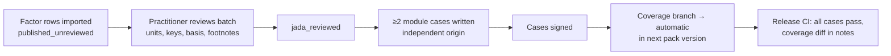

# 10 — Golden cases and verification

Prepared: 2026-11-09. Status: proposed. This keeps every verification requirement of the [v0 implementation plan](../v0-implementation-plan.md#automatic-method-scope-and-numerical-gates) and the [closure design gating tests](../v0-closure-design.md#9-gating-tests-and-removal-of-the-global-gate). It changes what humans review: expected answers instead of code.

> **Revised 2026-11-11:** The promotion workflow (§6) is replaced by workbook parity and ~12 signed scenario cases per pack ([00 §8](00-automation-first-plan.md#8-accuracy-verification-without-per-branch-signatures)). The case format and mutations are kept.

## 1. Why golden cases

v0 has 36.1k lines of backend tests, mostly written by the same agent that wrote the code. Many build their expected values by calling production helpers. The [plan](../v0-implementation-plan.md#automatic-method-scope-and-numerical-gates) itself says that "is not validation". No practitioner can read 36k lines of tests, and no one did.

A **golden case** is a small, readable file. It describes a facility's inputs and the answer a qualified person expects. The practitioner signs the *answer*. The engine must reproduce it exactly. This puts human judgement where it adds value and keeps code review for code.

## 2. Case file format

```yaml
# packs/shared/welding_arc/cases/c01-small-shop-e310.yaml
format: case-format/1
id: welding_arc/c01-small-shop-e310
title: Small shop, SMAW with E310 only
pins: {notice: notice_2025_2027, pack: metal_fab@2026.1}
purpose: >
  Listed-electrode path end to end. Chromium basis stays unresolved,
  so the Part 1A chromium assessment must remain pending.

facility:
  category: contiguous
  facts:
    G05.employee_hours: {state: known, value: "42000", unit: h}
entities:
  - {ref: a1, kind: activity, module: welding_arc, label: "Bay 1 stick welding"}
facts:
  - {question: P01, subject: facility_year, value: yes}
  - {question: P01-1, subject: a1, value: [SMAW], reviewed: true}
  - {question: P01-2, subject: a1, reviewed: true,
     value: [{process: SMAW, class: E310, mass: {value: "1200", unit: kg}, basis: used}]}
  # all other screens answered "no" by the case helper `screens_default: no` (explicit, visible in the file)
screens_default: no

expect:
  contributions:                         # exact Decimal; unit as written
    - {substance: "unresolved:chromium_basis", medium: air, quantity: "3.036", unit: kg,
       factor_row: "w2:p1:SMAW:E310:chromium"}
    - {substance: "part1B:NA - 19", medium: air, quantity: "2.256", unit: kg}      # 1200 × 1.88 / 1000
    - {substance: "part1A:NA - 09", medium: air, quantity: "2.64",  unit: kg}      # 1200 × 2.2 / 1000
    - {substance: "part1A:NA - 11", medium: air, quantity: "0.2352", unit: kg}     # 1200 × 0.196 / 1000
    - {substance: "part1B:NA - 05", medium: air, quantity: "0", unit: kg, slot_state: evidenced_zero}   # published zero
    - {substance: "part1A:NA - 14", medium: air, quantity: "0", unit: kg, slot_state: evidenced_zero}   # zinc, published zero
    - {substance: "unresolved:lead_subject_to_group_qualifier", medium: air, quantity: "0.0288", unit: kg}  # 1200 × 0.024 / 1000
    - {substance: "part4:NA - M09", medium: air, quantity: "18.12", unit: kg}
    - {substance: "part4:NA - M08", medium: air, quantity: "18.12", unit: kg}
    - {substance: "part4:NA - M10", medium: air, quantity: "13.59", unit: kg}
  assessments:
    - {part: part4, substance: "part4:NA - M10", outcome: not_met}
    - {part: part1A, substance: "part1A:NA - 04", outcome: pending, reason: identity_unresolved}
  open_items:                            # exact set of keys, by owner
    practitioner: [identity:chromium_basis]
    jada: [identity:lead_qualifier]
  readiness: {can_request_review: true, can_approve: false}
  strict: [contributions, open_items]    # sections compared as exact sets
  ignore: []                             # any ignored section needs a reason here

expected_value_origin: hand_worked       # hand_worked | official_example | recalculated_workbook | filed_history
worked_by: {name: "<HSE practitioner>", date: 2027-02-10, notes: "E310 rows from workbook Part 1 D23, Part 4 D16"}
signed_off:
  by: "<HSE practitioner>"
  role: practitioner
  date: 2027-02-15
  case_digest: "sha256:…"               # digest of everything above this block
```

The numbers above use the real v0 E310 factor values for illustration. The file is an example of the format. It is not signed, and the chromium and lead identity decisions it depends on are still open.

### Rules

1. **Exact.** Quantities compare as Decimal strings with no tolerance. A tolerance appears only in a reconciliation spec for measured data, declared by the method, not the case.
2. **Strict by default.** For sections listed in `strict`, extra or missing items fail. This is how "omission is not absence" is tested.
3. **Signed or not counted.** An unsigned case runs in CI but does not count toward any promotion gate. Changing anything above `signed_off` invalidates the signature (`case_digest`).
4. **Independent origin.** `expected_value_origin` must not be "engine output". A case whose expectations were pasted from a run is rejected at review.
5. **Small.** A module case covers one behavior. Whole-facility cases cover interactions. Most module cases are under 60 lines.

## 3. Kinds of cases

| Kind | Lives in | Purpose | Approximate count for metal_fab |
|---|---|---|---|
| Module case | `packs/shared/<module>/cases/` | One method path, eligibility branch or failure mode | 2–5 per module, ~70 total |
| Whole-facility case | `packs/metal_fab/cases/` | Cross-process aggregation, destinations, lifecycle | 18 (see [08 §7](08-welding-pack-design.md#7-golden-cases-the-pack-ships-with)) |
| Regulation boundary case | `regulation/notice_2025_2027/cases/` | Below/equal/above, ranges, qualifiers, facility cases, holds | ~60, from the [inventory's fixture table](../v0-regulatory-inventory.md#synthetic-boundary-and-regression-fixture-specifications) |
| Calculator case | `core/calculators/cases/` | Dimensional and arithmetic fixtures ([05 §7](05-calculators-and-factors.md#7-calculator-acceptance)) | ~8–15 per calculator |

## 4. Mutation cases: generated, not hand-written

The closure design requires an omission/mutation suite. In the new design these are **generated from signed whole-facility cases** by a mutation tool, with expected effects declared once per mutation type:

| Mutation | Expected effect (asserted automatically) |
|---|---|
| Drop any candidate substance from a source's floor | A targeted open item appears; `can_approve` becomes false |
| Add an undisclosed entity | A disposition item for it; `can_approve` becomes false |
| Change a screen from `no` to `unknown` | Classification item; no assessment becomes `not_met` that wasn't already |
| Remove evidence from an accepted fact | That review becomes stale |
| Change an upstream purchase quantity | Dependent facts become stale; current approval is invalidated |
| Bump a factor value in the pinned pack | Contributions change; re-pin diff is shown; filed revision replay is unchanged |
| Duplicate a contribution origin (automatic plus manual on one slot) | Collision item; blocks |
| Replace a known value with `unknown` | Never produces zero; dependent assessments `pending` unless a lower bound already meets the threshold |

One mutation definition multiplies across all signed facility cases. This gives hundreds of meaningful negative tests from a few dozen lines of mutation specs, instead of thousands of lines of hand-written negative tests.

## 5. Test layers

| Layer | Runs | Expected values from | Who reviews |
|---|---|---|---|
| Content validation | Every commit | Schema and contract rules | CI |
| Calculator tests | Every commit | Hand-worked and official examples | Developer + practitioner (meaning) |
| Rule function tests | Every commit | Notice text | Developer + practitioner |
| Stage unit tests | Every commit | Stage contract | Developer |
| Golden cases | Every commit; release gate | Signed expectations | Practitioner |
| Generated mutations | Every commit | Declared mutation effects | Developer |
| Property tests | Nightly | Invariants ([04 §7](04-engine-pipeline.md#7-testing-the-engine)) | Developer |
| API and lifecycle tests | Every commit | Lifecycle contract (kept from v0) | Developer |
| Browser journeys | Pre-release | Scripted client and JADA flows, desktop and mobile | Developer + JADA user |
| Parity harness | During migration only | v0 outputs | Developer; differences triaged with a practitioner |

Target size for the hand-written backend tests is roughly 8–12k lines, compared with v0's 36.1k. Coverage is broader because golden and generated cases carry most of the behavioral checking.

## 6. Promotion workflow for a method branch



A branch drops back to `manual_supported` automatically if any of its signed cases fails after a change. The release is blocked until the case or the code is fixed and re-signed.

## 7. C1–C12 in the new architecture

The gates are unchanged. This table shows where each is now evidenced.

| Gate | How it is verified |
|---|---|
| C1 Source/version coverage | Notice folder digests and amendment audit; pack coverage register compiled from modules; no fallback year (loader refuses) |
| C2 Discovery | Pack validation proves every screen and G17 is reachable; renderer journeys; mutation "screen → unknown" |
| C3 Facts and allocations | Fact model states (range, zero, unknown, unavailable) as schema tests; reconciliation cases f04/f05 |
| C4 Automatic calculations | Calculator cases, plus ≥2 signed module cases per automatic branch |
| C5 Manual calculations | `manual@1` cases; independent-review rule; staleness mutation |
| C6 Regulatory decisions | Regulation boundary cases (~60) |
| C7 Whole facility | f06 mixed-shop and f10 destinations, signed |
| C8 Review and freshness | Lifecycle API tests (kept), staleness mutations, browser journey |
| C9 Package | Export tests (kept from v0), filed-revision replay case |
| C10 Tenant and actor security | Kept v0 security tests, plus generic question-owner authorization tests |
| C11 Application quality | Build, lint, full suite, desktop and mobile journeys |
| C12 Handoff | Reproducible `jada-pack test` plus service start/stop scripts |

## 8. Learning from the filing season

During N3 (pilot filing), every case where JADA had to override, add a manual result or correct an answer is recorded with the reason. After the season, each override becomes either:

- a new golden case, where the engine was right but the inputs were tricky; or
- a factor-row or question change, where content was missing or wrong, with a new or updated golden case; or
- an engine or calculator issue with a regression case.

That is how the pack improves from real use without building code for rare branches in advance.
