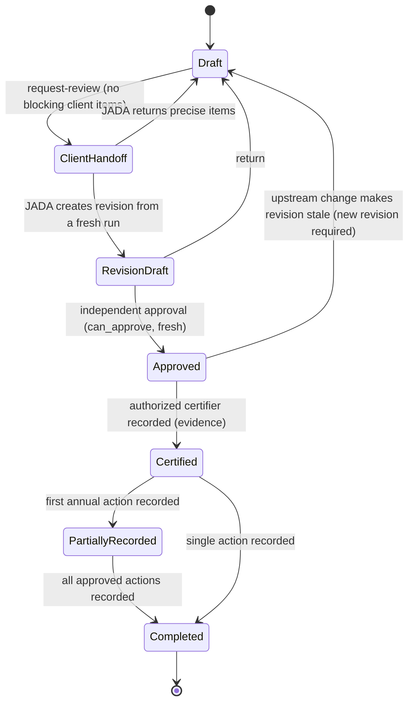

# 11 — Lifecycle, freshness and replay

Prepared: 2026-11-09. Status: proposed. This is the part of v0 that is kept most intact. v0's lifecycle work is careful and mostly industry-neutral: `digests.py` (692), `catalogue_snapshot.py` (612), `lifecycle_projection.py` (556), `package_export.py` (416) and the revision/event model. This document records what is kept, and the three things that change because content is now pinned packs and notices.

## 1. Lifecycle states (unchanged)



Unchanged rules from the [v0 plan](../v0-implementation-plan.md#freshness-and-retention-contract) and [closure design](../v0-closure-design.md#7-freshness-and-authoritative-readiness):

- Approval, certification and filing are separate, evidenced events by authorized actors.
- An export is not a filing.
- A no-filing determination completes with an internal evidenced event and never fabricates a government receipt.
- Multiple annual actions can coexist, and each is recorded separately.
- History is never edited. A correction creates a new revision and action.
- Evidence retained by a filed revision cannot be deleted through live SDS or document deletion.
- Retention is three years from the due date (Notice §34), and is enforced by preventing deletion, not by a cron job.

## 2. What a run pins

Every run records the exact content it used:

```text
RunManifest
  engine_version           e.g. "engine/1.3.0"
  engine_artifact_digest   digest of the released engine package
  notice                   {id: notice_2025_2027, content_digest}
  pack                     {id: metal_fab, version: 2026.1, content_digest}
  modules[]                {id, version, content_digest}           # resolved from the pack
  calculators[]            {id, version}                            # actually called
  rules[]                  {id, version}                            # actually called
  factor_rows[]            row IDs actually used (values are inside content_digest)
  input_digest             canonical digest of the InputBundle
  result_digest            canonical digest of the RunResult
```

The **content digest** of a notice or pack is the canonical hash of its whole folder. This includes the negative-scope content, such as rows and screens that did not fire. Retaining the full small catalogue, not only the rows used, was already the closure design's requirement for replay.

## 3. Freshness: one generic recomputation

At evaluate, request-review, revision creation, approval, certification and each annual action, the service:

1. rebuilds the `InputBundle` from current entities, facts, reviews and upstream records;
2. recomputes `input_digest` and each accepted review's `dependency_digest` ([03 §4](03-domain-model-and-facts.md#4-dependency-digests-and-staleness));
3. compares against the run and revision being acted on;
4. rejects the action if anything differs, and shows which facts and dependencies changed.

In v0, freshness hooks were added per feature (EGU, prior comparison, monthly split, shared residues and so on), which is why so many checkpoints were dependency repairs. In the new design the dependency kinds are a closed list declared on questions:

- `subject_facts`;
- `linked_entities`;
- `pinned_content`;
- `accepted_reviews_of`;
- `upstream_records`.

One function computes them all. A new question with the usual dependencies needs no freshness code.

Upstream records still matter. A purchase, SDS or inventory change made through the original JADA endpoints must invalidate dependent cases. This is kept as v0 implemented it: the bundle includes digests of linked upstream records.

## 4. Re-pinning content

A workspace is created pinned to the current released pack and notice. When a newer pack version is released (new electrode rows, a corrected factor, a new question):

- **Draft workspaces** show a "content update available" notice. JADA chooses `repin`, which re-evaluates and shows a **diff**: contributions added, changed and removed, new open items and changed assessments. Accepted facts stay accepted unless their declared `pinned_content` dependency changed. In that case they become stale with a pointer to the changed row.
- **Approved but unfiled revisions** become stale only if JADA re-pins. They are never re-pinned automatically. A factor correction that JADA judges material is handled by re-pinning and creating a new revision.
- **Filed revisions** are never re-pinned. They keep their content forever.

Automatic re-pinning during filing season is off by default.

## 5. Replay

A filed revision must be reproducible years later, after the engine and packs have changed. Requirements, adapted from the [closure design](../v0-closure-design.md#frozen-calculation-data-and-replay):

1. **Content is retained by digest.** Notice and pack folders are stored content-addressed (a `content_store` table or object storage), keyed by digest. Every released version is stored at release time.
2. **Calculator and rule versions are retained in code.** `activity_x_factor@1` stays registered after `@2` exists. Removing a version that any filed revision references is blocked by a CI check against a registry of referenced versions, exported nightly from production.
3. **Engine major versions are dispatchable.** The engine package keeps a small dispatch table from `engine/1.x` to the stage implementations. A missing historical implementation returns an explicit `unsupported_replay` result and never falls back to today's engine.
4. **A replay test runs on every release.** A fixed set of synthetic filed revisions is replayed with today's code, and the result digests must match. Repository loaders are deliberately broken in that test, to prove replay uses retained content only.

## 6. Annual actions and filing records (kept, data-driven)

The action plan comes from stage 7 using `annual_actions.yaml` ([07](07-regulation-as-data.md#9-obligations-and-filing-fields)). Each action has a stable `action_id`, type, scope, required flag and reason. Filing events reference action IDs and validate the type, scope, frozen revision, date and evidence. This is v0's design (`annual_actions.py`, lifecycle projection) unchanged in behavior. The difference is that the list of action types and their predicates is data with named validator functions.

## 7. Export

Kept from v0 (`package_export.py`, `filing_fields.py`):

- JSON for full reproducible data;
- CSV tables for filing review;
- HTML with print styling.

Exports escape HTML and protect CSV cells that begin with formula characters. Draft banners are prominent, and filenames are safe. The export reads only the frozen revision.

New in the export: a **content appendix** listing pinned notice and pack versions, modules, calculators, rules and every factor row used, with source locators and ratings. That makes a filed package self-explaining to an auditor without access to the codebase.

## 8. Carry-forward

`POST W/carry-forward` creates next year's workspace, pinned to the notice and pack for **that** year. If no pack exists yet for that year, the workspace is created with calculation blocked by a `developer` open item, `pack_not_released_for_year`.

Facts are copied only as **reconfirmation candidates** (provenance `carried_forward`, state requiring confirmation). Annual quantities, absence statements, exemptions, approvals and filings never carry forward silently. This is unchanged from v0.
