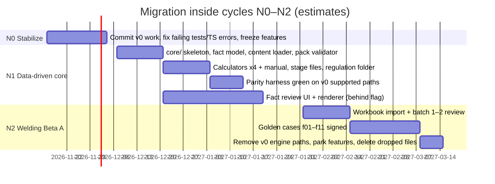

# 12 — Migration from v0

Prepared: 2026-11-09. Status: proposed plan. It is based on a read-only inspection of `JADA-NPRI-V0/backend` and `JADA-NPRI-V0/frontend` on branch `codex/welding-npri-v0`. **No code has been moved or changed.** Every step below needs explicit approval before it starts.

> **Revised 2026-11-11:** The strangler sequence and parity-harness gate are replaced by building on platform `main` and mining v0 ([00 §14](00-automation-first-plan.md#14-build-plan), ADR-017). The disposition tables remain the mining guide.

## 1. Principles

1. **No big-bang rewrite.** The new engine is built beside v0 and proves parity on v0's supported cases before any v0 path is removed.
2. **v0 is the oracle during migration.** Where v0 is correct, the new engine must match it. Where it differs, a practitioner decides which is right, and the decision becomes a golden case.
3. **Keep what is industry-neutral.** Lifecycle, digests, export, thresholds and aggregation are kept.
4. **Park, don't delete, what is premature.** Features built for rare branches go behind a flag and come back as pack modules when a client needs them.
5. **Commit v0 first.** At the time of writing, the v0 backend worktree has 178 uncommitted or untracked entries and the frontend has 24. HEAD is still the recorded starting SHA `ca29307`. Nothing can be migrated safely until that work is committed and reviewable (cycle N0).

## 2. File-by-file disposition

Line counts measured 2026-11-09.

### Keep (moves into `core/` with light renaming)

| v0 file(s) | Lines | New home | Notes |
|---|---|---|---|
| `workspace/digests.py` | 692 | `core/lifecycle/digests.py` | Add pinned content digests ([11 §2](11-lifecycle-freshness-and-replay.md#2-what-a-run-pins)) |
| `workspace/catalogue_snapshot.py` | 612 | `core/lifecycle/content_store.py` | Generalize from catalogue to notice and pack folders |
| `workspace/lifecycle_projection.py` | 556 | `core/lifecycle/projection.py` | Unchanged behavior |
| `workspace/package_export.py` | 416 | `core/lifecycle/export.py` | Add content appendix |
| `npri_v0/thresholds.py` | 479 | `core/engine/stages/assess.py` helpers | Becomes the body of `mpo_threshold@1` and `air_release_threshold@1` |
| `npri_v0/aggregation.py` | 216 | `core/engine/stages/aggregate.py` | |
| `npri_v0/facility_cases.py`, `rules.py` | 526 | `core/rules/` | Parameters move to `parts.yaml` and `facility_cases.yaml` |
| `npri_v0/identity.py`, `composition.py`, `material_lineage.py`, `balances.py` | 535 | `core/engine` helpers and `composition@1` | |
| `npri_v0/annual_actions.py` | 147 | `core/rules/annual_action_plan.py` | Action list moves to `annual_actions.yaml` |
| Workspace, revision, event, evidence models; lifecycle API routes | — | Kept tables (`runs`, `revisions`, `events`, `evidence`) | |
| Security fixes (signup role escalation, cross-tenant checks) | — | Kept as is | Not negotiable |

### Convert (behavior kept, shape changes)

| v0 file(s) | Lines | Becomes |
|---|---|---|
| `npri_v0/evaluator.py` | 5,945 | Eight stage files ([04](04-engine-pipeline.md)). Method-specific builders become calculators plus data. |
| `npri_v0/methods.py`, `process_methods.py`, `organic_methods.py`, `combustion.py`, `combustion_adapter.py` | 2,885 | `activity_x_factor@1`, `composition@1`, `mass_balance@1`, `fuel_combustion@1` plus module bindings ([05 §8](05-calculators-and-factors.md#8-where-v0s-method-code-goes)) |
| `npri_v0/coverage.py`, source closure in the evaluator | ~930 | Stage 2 (discover) |
| `npri_v0/reconciliation.py` | 732 | Stage 4 reconcilers |
| `npri_v0/reporting_obligations.py`, `reporting_duties.py`, `reporting_metadata.py`, `reporting_scope.py`, `reporting_completion.py`, `part1_reporting_completion.py`, `method_obligation_closure.py` | ~3,500 | Stage 7, plus `obligations.yaml`, `filing_fields.yaml` and validator functions |
| `npri_v0/readiness.py` | 579 | Stage 8 |
| `npri_v0/manual_mpo_completion.py` | 514 | Disappears. Manual MPO is a `manual@1` result on a material-assessment slot through the standard path. |
| `workspace/service.py` | 3,632 | `services/workspace.py` (entities, facts, reviews), `services/lifecycle.py` and `services/evaluate.py` (bundle building). Target under 1.5k total. |
| `workspace/*_review.py` (EGU, prior reporting, reporting, metadata, monthly, Part 4 method reporting, other process) | ~2,900 | One fact review flow |
| `schemas/workspace.py` + feature schemas | ~7,100 | Core question value schemas, plus fact/review/entity DTOs (~1.5k) |
| `workspace/catalogue_2026.json` | — | `core/common` questions plus `metal_fab` modules (typed) |
| `workspace/release_coverage_2026.json` | — | Module `coverage` entries |
| `workspace/filing_fields_2026.json`, `data/npri_v0/reporting_obligations_2026.json` | — | `regulation/notice_2025_2027/filing_fields.yaml`, `obligations.yaml` |
| `data/npri_v0/substances_2026.json`, `elemental_metal_cas_2026.json` | — | `regulation/notice_2025_2027/substances.json` and the identity aliases |
| `data/npri_v0/welding_candidate_factors.json` (12), `blasting_candidate_factors.json` (5), `natural_gas_candidate_factors.json` (2) | — | `factors.csv` in `welding_arc`, `thermal_cutting`, `thermal_spray`, `abrasive_blasting`, `boilers_heaters`. Superseded by the full workbook import for welding. |
| `frontend/src/routes/admin.workspace.tsx`, `_client.workspace.tsx` | 10,850 | Section shells plus the form renderer |
| `frontend/src/components/workspace/*` (43 files) | 11,305 | Renderer, fact review, manual result, the five custom screens. `material-use-review.tsx`, `material-batch-*`, `receiving-entities-*`, `lifecycle.ts` and `package-export-button.tsx` are the best starting points for the custom screens. |

### Park (behind a flag; rebuilt as pack modules or duties when a client needs them)

| Feature | v0 footprint (approximate) | Why park | How it returns |
|---|---|---|---|
| Part 4 electricity generating units (EGU) — positive branch, details, review, editors | ~7.3k (backend + frontend) | No welding pilot shop is expected to operate a ≥25 MWe unit | `obligations.yaml` duty `part4_egu_details` plus a `power_generation` module |
| Part 4 prior-year comparison | ~1.9k | Useful, but a reporting nicety; not a calculation gate for first filings | Filing-field question `F.part4.prior_comparison` with a validator |
| Part 4 monthly distribution review UI | ~0.6k | The duty is real (Sch. 4 §20) | Filing-field table question plus `monthly_percentages_sum_to_100@1` |
| Condensable PM review | ~0.4k | The duty is real | Filing-field enum question |
| Part 5 low-hours oil-and-gas and crude-battery branches | small | Not a welding case | Stays in rule functions, tested by regulation boundary cases |

"Park" means the code is retained on a branch or tag. The duty is declared `parked` in `obligations.yaml`, so a facility that triggers it gets a blocking `developer` item. It is never silently skipped. The monthly distribution and condensable PM duties apply to many facilities that meet Part 4. They are re-implemented as filing-field questions in N1–N2 rather than kept parked.

### Drop

| Item | Reason |
|---|---|
| Duplicate pure/review module pairs (for example `npri_v0/part4_prior_comparison.py` plus `workspace/part4_prior_comparison.py`; `part4_method_reporting.py` in both packages) | Replaced by the fact model |
| `pending_evaluator.py` (202) | The new pipeline has no "pending-only" adapter. The engine contract version gates readiness. |
| `storage-v0/` test evidence (2,571 files) | Synthetic run artifacts; regenerate when needed |
| `/tmp` log references in checkpoints | Not evidence anyone can retrieve |

### Mine (then delete)

| Item | Lines | What to extract |
|---|---|---|
| Agent-written backend tests | 36.1k | Scenarios and boundary values become golden cases, regulation boundary cases or calculator cases. Assertions that only restate implementation are deleted. |
| Synthetic mixed-facility fixtures (`completed_mixed_facility_fixture.py` and similar) | — | Sources for f06/f10. Fix the known coating-chemistry issue in the case, not in code. |
| Implementation-plan checkpoints (1,554-line log) | — | Each "correction" entry is a candidate regression case. The ~39 repair entries are a list of known pitfalls to test. |

## 3. Parity harness

The harness is used only during N1–N2.

```text
tools/parity/
  cases/              # v0-supported scenarios exported as InputBundles (synthetic only)
  run_v0.py           # calls v0 evaluate_frozen_inputs on each bundle (read-only import)
  run_new.py          # calls core.engine.evaluate with pinned content
  compare.py          # normalizes both results: contributions, assessments, open items
  triage.md           # every difference: who decided, which is right, resulting golden case
```

- **Scope:** the v0 supported paths — E310 SMAW listed; oxy cutting PM10; plasma spray; dry-sand blasting; natural-gas small boiler; solvent and coating balances; manual results; Part 1 MPO from composition; batch lineage; G17 mapping; no-filing path.
- **Comparison:** contributions by (substance, basis, quantity kind, medium/category) exact Decimal; assessments by outcome and reason class; open items by kind and owner. Identifiers differ by design and are mapped, not compared.
- **Exit criterion for N1:** zero unexplained differences. Every explained difference is either a v0 defect fixed in the new engine (with a golden case) or a new-engine defect fixed. Each has a triage entry signed by the reviewer.

## 4. Data migration

The pilot hasn't filed with v0 and all v0 data is synthetic, so the migration is a one-time transform for development continuity, not a production data migration:

| v0 store | New store | Transform |
|---|---|---|
| `facility_workspaces.inputs.activities`, `materials`, `allocations`, `material_flows`, `controls`, `outlets`, `streams`, `incidents` | `entities` + `entity_refs` | One entity per item; IDs preserved |
| `inputs.screens`, `inputs.answers`, `inputs.facts`, `inputs.employee_hours`, `inputs.facility` | `facts` | Question IDs preserved (G01–G17, Pxx-n); values typed by the new schemas; untyped `text_or_structured` answers stay text and are flagged for re-entry |
| `workspace_resolutions` (15 payload types) | `facts` (core `jada.*` / `F.*` questions) + `reviews` | Per the [mapping table](03-domain-model-and-facts.md#31-how-the-15-v0-resolution-kinds-map) |
| `workspace_evidence`, `workspace_runs`, `workspace_revisions`, `workspace_events` | Same tables | Runs and revisions keep v0 engine version labels. They are history, not replayed by the new engine. |

If a real client case exists in v0 by the time migration runs, it is re-entered through the new UI rather than transformed. A client package's history should not depend on a one-off script.

## 5. Sequence



Dates are estimates assuming 2 developers and a part-time HSE practitioner ([13](13-delivery-cycles.md)). The calendar includes the December holidays, which is why N1 spans eight calendar weeks for about six weeks of work.

## 6. What could go wrong in migration

| Risk | Mitigation |
|---|---|
| Parity differences that are really v0 bugs get "fixed" in the new engine to match v0 | Triage requires a practitioner decision for any regulatory difference. Matching v0 is not the goal; being right is. |
| The fact model is too generic for some v0 payload (for example source scope with many references) | Question value schemas can be rich nested types. The rule is one review flow, not flat values. |
| Two systems running in parallel confuse users | The new UI stays behind a flag, used only by JADA staff with synthetic cases until N2 |
| Uncommitted v0 work is lost | N0 commits everything first, on the existing branch, with a reviewed history. Never reset or clean ([workspace rules](../../../../AGENTS.md)). |
| Line-count targets are missed | Targets are a budget, not a gate. A stage over ~400 lines triggers a design review, not a failure. |
