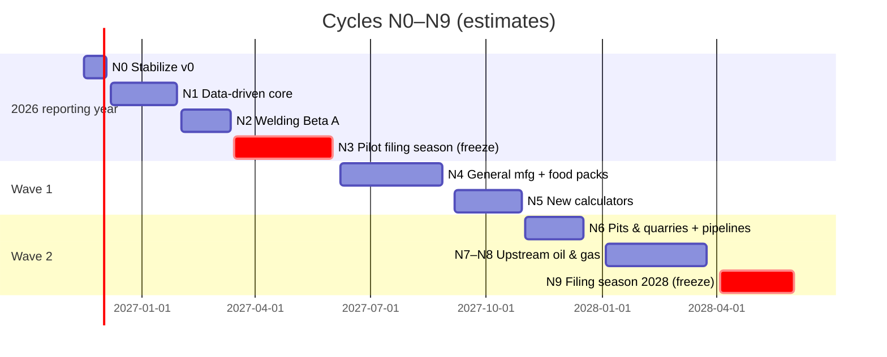

# 13 — Delivery cycles

Prepared: 2026-11-09. Status: proposed plan. Dates are **estimates** assuming 2 developers and a part-time HSE practitioner (about 0.5 FTE). Stretch them proportionally if the team is smaller. The fixed point is the regulatory deadline: 2026 data is due **June 1, 2027** ([ECCC deadlines](https://www.canada.ca/en/environment-climate-change/services/national-pollutant-release-inventory/report/deadlines-changes.html)). These cycles carry the same numbering as the [all-industry scope](https://claude.ai/artifact/BjfGdcG6SJU5E8JPszasGs).

> **Revised 2026-11-11:** Cycles up to June 2027 are replaced by A0–A3 in [00 §14](00-automation-first-plan.md#14-build-plan). N4 onward remains the outline for after the filing season.

## 1. Overview

## 2. Rules for every cycle

1. **One pack or platform theme per cycle.** The next does not start until the current gate passes.
2. **A gate is practitioner-signed golden cases plus the listed checks.** It is never a line count or a test count.
3. **Feature freeze during filing seasons** (mid-March to June 1). Only fixes and content corrections are allowed.
4. **Slice size.** Each PR or agent task is one reviewable slice of about 1–3k lines, committed and reviewed before the next starts. No more 100k-line branches reviewed at the end.
5. **Budgets are tracked, not enforced.** Lines per stage and per calculator, and frontend size, are reported each cycle. A breach triggers a design review.
6. **Re-score priorities each summer** with the new NPRI data and pilot feedback.

## 3. N0 — Stabilize v0 (16 Nov – 4 Dec 2026, ~3 weeks)

**Goal:** a committed, reviewable, green v0 that can serve as the parity oracle.

| Week | Work | Owner |
|---|---|---|
| 1 | Commit the uncommitted v0 work (178 backend and 24 frontend entries) on `codex/welding-npri-v0` in logical commits; record the starting state | Dev A |
| 1 | Fix the failing backend tests found in the audit (the manual-MPO fixture label at `completed_mixed_facility_fixture.py:319` and related) | Dev B |
| 2 | Fix the TypeScript errors, including the admin workspace screen crash; reduce lint from 68 errors toward 0 without reformatting unrelated files | Dev B |
| 2 | Freeze v0 features. Write the list of v0-supported paths for the parity harness. | Dev A |
| 3 | Export synthetic parity bundles from v0. Confirm the full regression suite is green against the isolated `_test` database. | Dev A + B |
| 1–3 | Practitioner: read [08](08-welding-pack-design.md) and the electrode batch list; pick the first pilot shops and their real process mix | HSE |

**Exit gate:**

- clean test run (backend suite, frontend build and tests) with the commands recorded;
- reviewed commit history;
- parity bundle set exported;
- no new features added.

## 4. N1 — Data-driven core (7 Dec 2026 – 29 Jan 2027, ~6 working weeks)

**Goal:** the new core runs v0's supported paths from data and matches v0.

| Week | Work | Detail |
|---|---|---|
| 1 | `core/` skeleton, types, content loader, pack and notice validators | [02](02-architecture-overview.md), [06 §7](06-pack-format-spec.md#7-validation-load-time-and-release-time) |
| 1–2 | Fact model, entities, reviews, migrations, generic authorization by question owner | [03](03-domain-model-and-facts.md) |
| 2 | Regulation folder `notice_2025_2027/` from v0 data; rule functions ported from `thresholds.py`, `facility_cases.py` and `rules.py` | [07](07-regulation-as-data.md) |
| 2–3 | Calculators `activity_x_factor@1`, `composition@1`, `mass_balance@1`, `fuel_combustion@1`, `manual@1` with acceptance fixtures | [05](05-calculators-and-factors.md) |
| 3–4 | Stages 1–8 ported from the evaluator, one at a time, each with unit tests | [04](04-engine-pipeline.md) |
| 4–5 | `metal_fab@2026.0` with modules for the v0-supported paths only (E310, oxy cutting, plasma spray, dry-sand blasting, NG boiler, solvent and coating balances); parity harness | [12 §3](12-migration-from-v0.md#3-parity-harness) |
| 3–6 | Form renderer, fact review, open-item queue, results and trace (behind a flag) | [09](09-review-workflow-and-generated-ui.md) |
| 5–6 | Lifecycle wiring: runs pin content, freshness recompute, export content appendix | [11](11-lifecycle-freshness-and-replay.md) |
| 1–6 | Practitioner: review the first electrode batch rows from a trial import; draft f01–f05 | [08 §3](08-welding-pack-design.md#3-importing-the-full-eccc-workbook) |

**Exit gate:**

- parity harness has zero unexplained differences on v0-supported paths;
- the E310, blasting and natural-gas cases give v0's numbers from data rows;
- no engine file over ~400 lines;
- the boundary check (no module, question or substance literals in `core/engine`) passes;
- renderer journeys work for P01, P08 and P20.

## 5. N2 — Welding Beta A (1 Feb – 12 Mar 2027, ~6 weeks)

**Goal:** pilot-ready welding pack with the Beta A content in [08 §6](08-welding-pack-design.md#6-beta-a-and-beta-b-content).

| Week | Work |
|---|---|
| 1 | Full workbook import (`jada-pack import`); manifest counts frozen; substance map reviewed |
| 1–2 | Electrode batches 1–2 promoted (`jada_reviewed`); Method 1 "Other" binding; PM2.5 derivation; cutting metals speciation |
| 2–3 | All 28 screens and modules present with typed questions; manual-supported modules complete with `manual_result` |
| 3–4 | Golden cases f01–f11 written and signed; module cases for each automatic branch |
| 4 | Custom screens: material reconciliation, source-to-outlet map, package and lifecycle |
| 5 | Remove v0 engine paths behind the flag; park EGU, prior comparison and low-hours O&G; re-implement monthly distribution and condensable PM as filing-field questions |
| 5–6 | Browser journeys (desktop and mobile), security regression, staging rehearsal with 2 synthetic pilot shops end to end |

**Exit gate:**

- the HSE practitioner signs the 11 pilot scenarios;
- every present activity in each selected pilot shop is resolvable;
- C1–C12 evidence recorded for the Beta A scope ([10 §7](10-golden-cases-and-verification.md#7-c1c12-in-the-new-architecture));
- the new UI is the default for staff.

## 6. N3 — Pilot filing season (15 Mar – 1 Jun 2027)

**Goal:** 3–5 welding and fabrication shops file their 2026 data through JADA.

- Onboard shops in two waves: two in March, the rest by mid-April.
- Content fixes allowed: factor-row corrections, help text, new rows for an electrode a pilot shop actually uses, with batch review and a case.
- Code changes are limited to bug fixes. Every change ships with a golden or regression case.
- Every JADA override or manual result is logged with a reason for the [learning loop](10-golden-cases-and-verification.md#8-learning-from-the-filing-season).

**Exit gate:**

- pilot reports filed (or a no-filing or DNMC determination recorded) by June 1, 2027;
- override log complete.

## 7. N4 — Wave 1 packs: general manufacturing and food (Jun – Aug 2027, ~10 weeks)

- Convert the override log into cases and content first (about 2 weeks).
- Beta B welding content: coating, process chemicals, more fuels, Method 2, remaining electrode batches.
- `general_mfg` pack: printing, coating lines, plastics molding, plating (manual), adhesives. Mostly shared modules.
- `food` pack: fryers and ovens (combustion), ammonia refrigeration (`maintenance_incidents` plus a new `refrigeration` module), fermentation and ethanol VOC (`mass_balance`), wastewater (manual).
- These two packs add about 815 facilities and 469 companies to the addressable base (2024 NPRI data).

**Exit gate:** golden cases signed and coverage registers closed for both packs; welding Beta B promoted branches signed.

## 8. N5 — New calculators (Sep – Oct 2027, ~8 weeks)

`tank_losses`, `flaring`, `equipment_leaks`, `fugitive_dust`, `sour_gas_so2`. Each comes with acceptance fixtures matching the ECCC calculator or AP-42 worked example it implements. `measured_concentration` is built if N4's water and waste demand justified it (rule of two).

**Exit gate:** every calculator matches its official worked example. A developer other than the author has reviewed it, and a practitioner has confirmed its meaning.

## 9. N6 — Pits and quarries, pipelines and terminals (Nov – Dec 2027, ~6 weeks)

Few new processes; mostly the N5 calculators. Includes the production-based applicability branch for pits and quarries (§1(1)(a) ≥500,000 t; §1(2) exclusion below it) and terminal operations. The playbook is worked through in [14](14-adding-an-industry.md).

**Exit gate:** golden cases and the pits-and-quarries applicability rule cases signed.

## 10. N7–N8 — Upstream oil and gas (Jan – Mar 2028, ~12 weeks)

Dehydrators, sweetening, compressors and produced water, plus shared tanks, flares and leaks. Platform additions:

- bulk import for multi-site operators;
- consultant accounts managing many facilities (buyers here average about 20 facilities each);
- the Part 4 §11(2) and Part 5 low-hours O&G branches, already in rule functions.

**Exit gate:** one operator or consultant runs a 20+ facility portfolio in staging before the 2028 filing season.

## 11. N9 — Filing season 2028 (Apr – 1 Jun 2028)

Welding, Wave 1 and early oil-and-gas clients file 2027 data. Freeze as in N3. **Notice check:** the 2025–2027 notice covers reporting year 2027. A new notice is expected for 2028 data and must be monitored from Q4 2027 ([07 §10](07-regulation-as-data.md#10-adding-the-next-notice)).

## 12. After H2 2028

- Wave 3: waste and wastewater, wood products, electricity, chemicals.
- Wave 4, only with an anchor client paying for the pack: cement, primary metals, mining, pulp and paper, oil sands, refining.

## 13. How the old cycle numbers map

| Old (roadmap / v0 plan) | New |
|---|---|
| C00 Source and rule baseline | N1 regulation folder + `holds.yaml`; amendment audit gate |
| C01 Facility discovery | N1–N2 pack screens and renderer |
| C02 Facts and allocations | N1 fact model; N2 material reconciliation screen |
| C03 Assessment and method contracts | N1 stages, calculators and open items |
| C04 Core arc welding | N2 workbook import, batches 1–2, Method 1 |
| C05 Cutting and thermal spray | N2 (listed rows plus speciation) |
| C06 Blasting and mechanical finishing | N2 dry sand; N4 others manual→automatic as justified |
| C07 Cleaning and coatings | N2 solvent balance; N4 coating |
| C08 Energy and heat | N2 NG boiler; N4 other fuels |
| C09 Yard and storage | N5 calculators; welding modules promoted after |
| C10 Specialist case intake | N2 manual-supported modules (all present from Beta A) |
| C11 Whole-facility completion | N2 stages 4–7 plus f-cases |
| C12 Review and report package | N1–N2 lifecycle (kept) |
| C13 Pilot regression and next year | N3 learning loop; N4 carry-forward |
| V00–V08 phases | N0 (V00) and N1–N2 (V01–V08 scope, delivered through the new structure) |

## 14. Metrics reported each cycle

| Metric | Why |
|---|---|
| Automatic branches / manual-supported / unsupported (per pack) | Honest coverage |
| Factor rows by `review_state` | Shows how much imported data is actually trusted |
| Golden cases signed / failing | The real progress measure |
| Open items per pilot case by owner, median | Client and JADA effort |
| Lines added per new process family (code vs data) | Checks the architecture claim (~0.2k code vs ~3.9k in v0) |
| Engine and frontend size vs budget | Early warning for drift |
| Repair share of merged PRs | v0 was 39 of 104. Target under 15%. |
